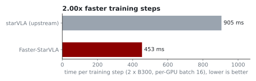
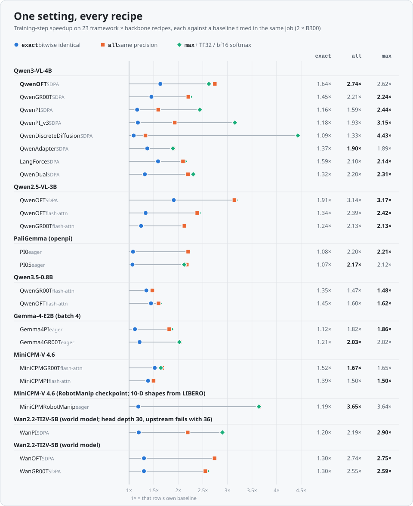
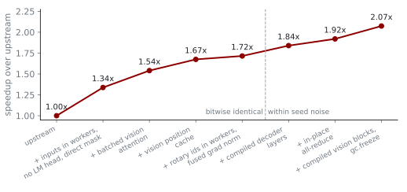
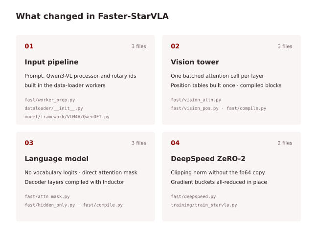

# Faster-StarVLA

[English](README.md) | [简体中文](README.zh-CN.md)

**2.00× faster starVLA training steps with one environment variable, optimized by an AI agent following the [ResearchBoost-Agent](https://github.com/DAGroup-PKU/ResearchBoost-Agent) method.**

<p align="center">
  <picture>
    <source media="(prefers-color-scheme: dark)" srcset="docs/faster/figures/benchmark-dark.svg">
    
  </picture>
</p>

| Implementation | Time / training step (ms) ↓ | Speedup ↑ |
|---|---:|---:|
| Baseline | 905.4 | 1.00× |
| `STARVLA_FAST=exact` (bitwise identical) | 521.9 | 1.74× |
| **`STARVLA_FAST=all`** (statistically equivalent) | **453.3** | **2.00×** |

Measured on **2 × NVIDIA B300** with starVLA's LIBERO recipe (QwenOFT on Qwen3-VL-4B, batch 16 per GPU, every
parameter trainable). No config, script or framework is changed. [Measurement details](docs/faster/measurement.md).

## Quick Start

Set up as in the [upstream instructions](README.upstream.md), then:

```bash
export STARVLA_FAST=all      # 2.00x; or exact (1.74x, bitwise identical) or max (+ TF32 / bf16 softmax)
bash examples/simBenchmarks/LIBERO/train_files/run_libero_train.sh
```

Every fast path checks the model it gets and skips itself where it does not apply; the start-up log lists which ones
are on. Add or remove one by name: `STARVLA_FAST=all,-compile_lm`. The same variable works for the policy server.

## Every recipe

23 framework × backbone recipes, each against its own baseline timed in the same job: `all` gives
1.33× to 3.65×, `max` up to 4.43× (QwenDiscreteDiffusion on Qwen3-VL-4B).

<p align="center">
  <picture>
    <source media="(prefers-color-scheme: dark)" srcset="docs/faster/figures/coverage-dark.svg">
    
  </picture>
</p>

[Table, notes and what is not measured](docs/faster/details.md#other-frameworks-and-backbones).

## Agent Optimization History

Each column is one timing run of the headline recipe against the frozen baseline (906.9 ms).
[Work log](docs/faster/WORK_LOG.md), including the rounds that did not help.

<p align="center">
  <picture>
    <source media="(prefers-color-scheme: dark)" srcset="docs/faster/figures/history-dark.svg">
    
  </picture>
</p>

- **Data loader:** prompt building, the VLM processor and rotary position ids run in the loader workers.
- **Vision tower:** one batched attention call per layer instead of one per image; cached position tables; compiled blocks.
- **Language model:** no unused vocabulary logits; a direct attention mask; compiled decoder layers.
- **Optimizer step:** no fp64 copy of every gradient for the clipping norm; in-place all-reduce; a compiled AdamW update.
- **Other backbones:** world models stop carrying their frozen-in-practice text encoder and VAE in the optimizer
  (on Wan about 100 ms per step and 42–52 GiB of peak memory); MiniCPM-V's per-chunk vision tower stays on flash-attention (3×).

## How it works

<p align="center">
  <picture>
    <source media="(prefers-color-scheme: dark)" srcset="docs/faster/figures/module-map-dark.svg">
    
  </picture>
</p>

One package, [`starVLA/fast/`](starVLA/fast/__init__.py), called from four hooks that belong to no framework: where
the backbone, the framework, the DeepSpeed engine and the data loader are built.

| Level | Adds | Compared with upstream |
|---|---|---|
| `exact` | work moved off the critical path or skipped | **bitwise identical** (deterministic mode) |
| `all` | compiled layers and other reorderings at the same precision | within **3σ** of upstream's seed-to-seed spread |
| `max` | TF32 for fp32 heads, bf16 softmax in PI0 / PI05 | statistically equivalent, lower precision in places |

[All 28 fast paths](docs/faster/details.md#every-fast-path) · [FAQ](docs/faster/details.md#faq)

## Validation

Judged by a frozen evaluator built before optimization started ([how it decides](docs/faster/details.md#validation)):

- **`exact`:** 23,336 recorded tensors of two training steps (loss, every fp32 gradient, update and Adam state)
  are bitwise identical to upstream.
- **`all`:** every training endpoint stays within 3σ of upstream's own seed-to-seed spread; a run with the learning
  rate × 1.02 is rejected.
- **End to end:** 30,000 steps with every fast path give a LIBERO average of 97.3% (the released checkpoint,
  evaluated the same way: 98.65%).

## Upstream starVLA

Based on [starVLA/starVLA](https://github.com/starVLA/starVLA) at `99764f5` by the StarVLA Community
([paper](https://arxiv.org/abs/2604.05014), [MIT license](LICENSE)). Environment, data, training and evaluation:
[README.upstream.md](README.upstream.md).
