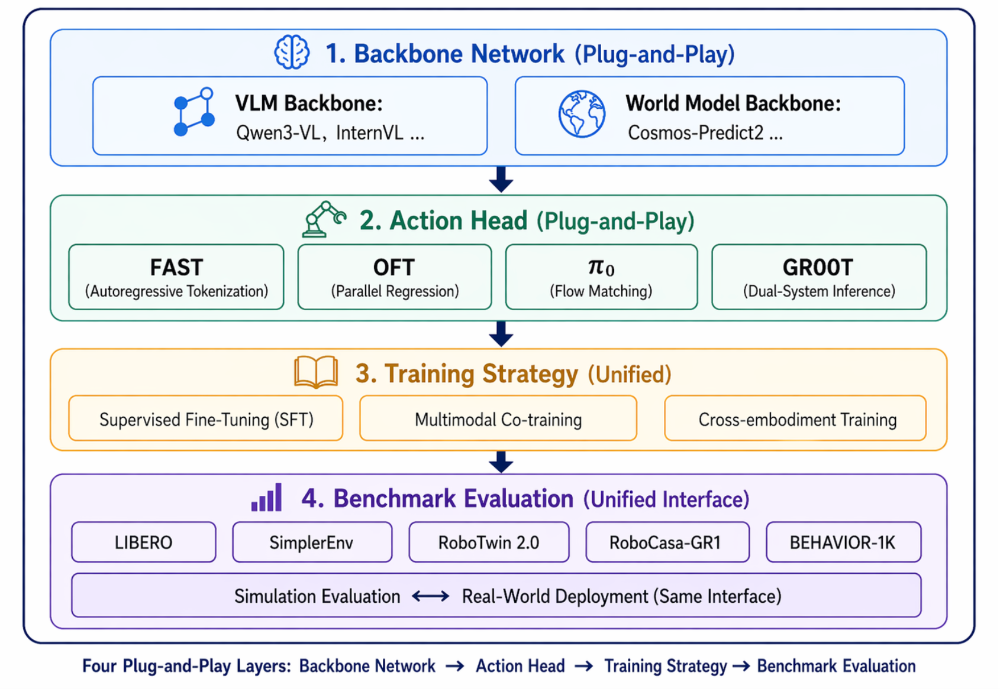
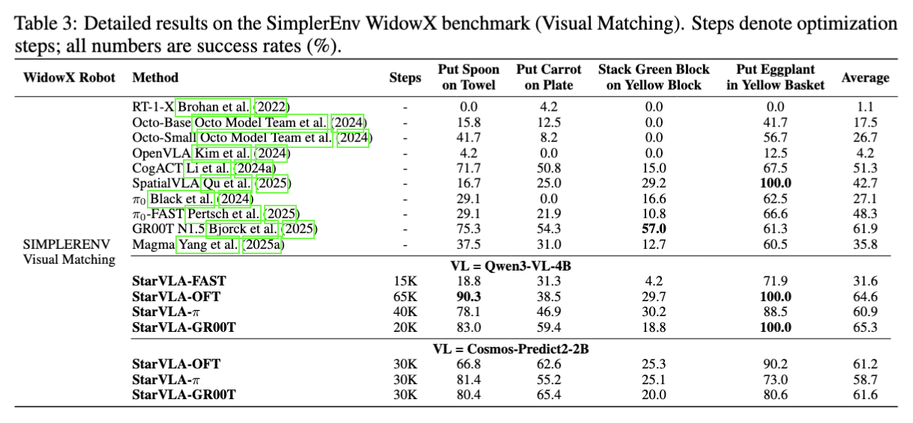
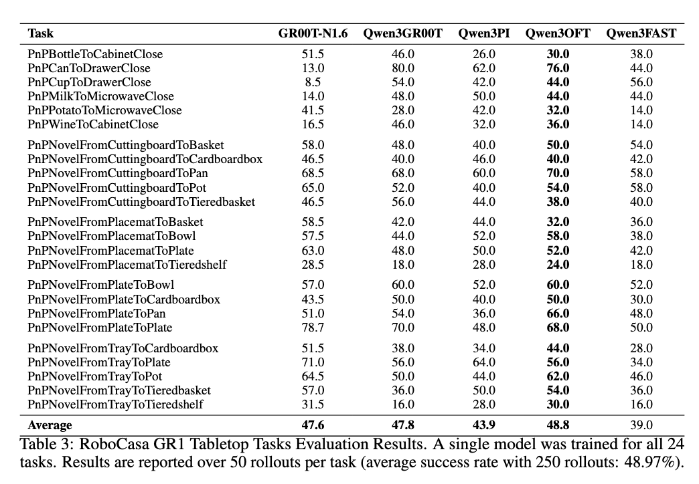
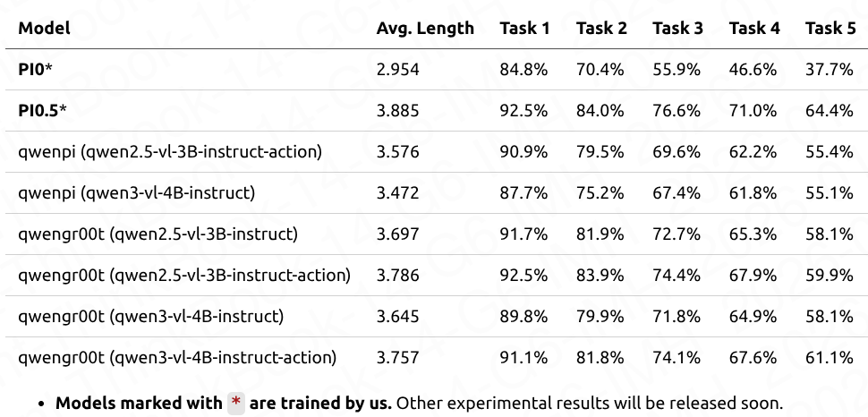

# Faster-StarVLA

[English](README.md) | [简体中文](README.zh-CN.md)

**2.00× faster starVLA training steps, optimized by an AI agent following the [ResearchBoost-Agent](https://github.com/DAGroup-PKU/ResearchBoost-Agent) method.**

Faster-StarVLA is [starVLA](https://github.com/starVLA/starVLA) plus one package, [`starVLA/fast/`](starVLA/fast/__init__.py):
25 fast paths for the data loader, the backbone, the action head and the DeepSpeed optimizer step, selected by one
environment variable. With `STARVLA_FAST=exact` a training step is bitwise identical to upstream in deterministic mode, only faster; `all` adds
compiled layers and other changes that keep the precision of every operation; `max` adds precision settings. Configs,
scripts and frameworks stay as they are.

<p align="center">
  <picture>
    <source media="(prefers-color-scheme: dark)" srcset="docs/faster/figures/benchmark-dark.svg">
    
  </picture>
</p>

| Implementation | Time / training step (ms) ↓ | Speedup ↑ |
|---|---:|---:|
| Baseline | 905.4 | 1.00× |
| Faster-StarVLA, `STARVLA_FAST=exact` (bit-exact) | 521.9 | 1.74× |
| **Faster-StarVLA, `STARVLA_FAST=all`** | **453.3** | **2.00×** |

Measured on **2 × NVIDIA B300** with starVLA's [LIBERO recipe](examples/simBenchmarks/LIBERO/README.md): QwenOFT on
Qwen3-VL-4B, per-GPU batch 16, all 4.50 B parameters trainable. At the `exact` level, the training steps in
deterministic mode are **bitwise identical** to the baseline. [Setup and measurement details](docs/faster/measurement.md);
[other frameworks and backbones](#other-frameworks-and-backbones).

These figures are from the session in which the baseline timing was frozen. In three later sessions the baseline itself ran faster (796 to 816 ms instead of 905 ms), and the same comparison gave 1.87× to 1.96× for `all` and 1.56× to 1.65× for `exact` ([sessions](docs/faster/measurement.md#the-judge-on-the-unified-code)).

- **Exact or equivalent, your choice.** `exact`: 1.74×, with 23,336 recorded tensors bitwise identical to
  upstream. `all`: 2.00×, every training endpoint within 3σ of upstream's own seed-to-seed spread.
- **Not just one recipe.** 14 framework × backbone recipes measured, each against its own baseline: `all`
  gives 1.33× to 3.20×, `max` up to 4.43× (QwenDiscreteDiffusion on Qwen3-VL-4B).
- **Trains a working policy.** 30,000 steps with all fast paths on 2 GPUs reach a LIBERO average of 97.3% (the
  released 8-GPU checkpoint, evaluated the same way: 98.65%).
- **No framework edited.** Four hooks call the package; every fast path checks the model it is given and skips itself
  where it does not apply.

## Contents

[Quick start](#quick-start) · [How it works](#how-it-works) · [Every fast path](#every-fast-path) ·
[Optimization history](#agent-optimization-history) · [Other frameworks and backbones](#other-frameworks-and-backbones) ·
[Validation](#validation) · [FAQ](#faq) · [Upstream documentation](#upstream-starvla-documentation)

## Quick Start

Prepare the environment, weights and data as in the [upstream instructions](README.upstream.md). One environment
variable selects the fast paths, for every framework and backbone:

```bash
export STARVLA_FAST=all      # every fast path that keeps the precision of every operation: 2.00x
# export STARVLA_FAST=exact  # only the fast paths that are bitwise identical to the baseline: 1.74x
# export STARVLA_FAST=max    # all + precision settings (TF32 for the fp32 action heads): see "How it works"

bash examples/simBenchmarks/LIBERO/train_files/run_libero_train.sh
```

Unset (or `off`), the code runs the baseline code paths. Each fast path checks the model it is given and is skipped
where it does not apply; the log says which ones are on:

```
[starVLA.fast] _QWen3_VL_Interface: attn_mask, hidden_only, vision_attn, vision_pos, vision_attn_relaxed, compile_lm, compile_vision
[starVLA.fast] DeepSpeedEngine: grad_norm, allreduce
```

Single paths can be added or removed by name (`STARVLA_FAST=exact,-worker_prep,compile_lm`). The same variable
works for inference: set it for the policy server.

## How it works

### Three levels

The levels differ in what they allow to change, and each was judged by the standard that fits it:

| Level | What it adds | Compared with upstream | Judge tier | Headline recipe |
|---|---|---|:---:|---:|
| `exact` | Work moved off the critical path or not done at all: input processing in the data-loader workers, no unused vocabulary logits, mask and position tables without per-call overhead, batched attention calls only where a probe proves them bitwise identical, leaner DeepSpeed bookkeeping | **Bitwise identical** in deterministic mode: loss, every gradient, update and optimizer state (and, where checked on real weights, the actions of `predict_action`) | N0 | 1.74× |
| `all` | `exact` + changes that keep the precision of every operation but may change the order of floating-point rounding: Inductor-compiled layers, SDPA instead of flash-attention, batched attention for every shape, conditioning projected once, a compiled AdamW update | **Statistically equivalent**: every training endpoint within 3σ of upstream's seed-to-seed spread | N1 | 2.00× |
| `max` | `all` + precision settings: TF32 for fp32 matrix products (the fp32 action heads), bf16 softmax in PI0 / PI05 attention | Statistically equivalent, with some operations at lower precision | N2 | no further gain (little fp32 work) |

Deterministic mode is the setting in which upstream reproduces itself bit for bit; outside it, two runs of upstream
generally differ in the last bits already (GPU reductions in varying order), so a bitwise comparison means something
only there. The judge's tiers are the ones
of [ResearchBoost-Agent](https://github.com/DAGroup-PKU/ResearchBoost-Agent): N0 bitwise, N1 reordered at the same
precision, N2 a dtype or math mode changed.

### Where each fast path acts

<p align="center">
  <picture>
    <source media="(prefers-color-scheme: dark)" srcset="docs/faster/figures/module-map-dark.svg">
    
  </picture>
</p>

All of it lives in one package, [`starVLA/fast/`](starVLA/fast/__init__.py), called from four places that belong to no
framework: where a backbone is built (`get_vlm_model`), where a framework is built (`build_framework`), where the
trainer gets its DeepSpeed engine, and where the data loader is built. No framework and no backbone interface
contains a switch or a line of it. A fast path is a module with `apply(target) -> bool` and one line in
[`FAST_PATHS`](starVLA/fast/__init__.py); it returns `False` where it does not fit, and the log lists it as not applicable.

## Every fast path

| Fast path | Level | Acts on | What it does, and where it applies |
|---|---|---|---|
| `worker_prep` | exact | data loader | the prompt construction, the VLM processor and the rotary position ids run in the data-loader workers instead of the training process; every framework that hands the batch's images and prompts to its backbone interface (`build_qwenvl_inputs`), on the Qwen2.5-VL, Qwen3-VL and Cosmos-Reason2 interfaces; a framework that edits the prompt registers the edit in one function |
| `worker_examples` | exact | data loader | PI0 / PI05: the framework's own sample preparation (image resize and padding, state and action padding) runs in the data-loader workers |
| `vision_attn` | exact | vision tower | one batched attention call per layer instead of one call per image with a host synchronization in every layer; Qwen2-VL / Qwen2.5-VL / Qwen3-VL vision towers with SDPA attention, for the image shapes where a probe on the running GPU shows the batched call is bitwise identical |
| `vision_pos` | exact | vision tower | position tables built once per grid size instead of in every forward; Qwen2-VL / Qwen2.5-VL / Qwen3-VL vision towers |
| `attn_mask` | exact | language model | the causal + padding mask from two broadcasted tensor ops instead of four nested `torch.vmap` calls; any backbone whose transformers model builds its mask with `masking_utils` (Qwen, Gemma, Llama, Phi families), with SDPA attention |
| `hidden_only` | exact | language model | the unused vocabulary logits are not computed; any backbone with an LM head, in calls that ask for hidden states without labels |
| `grad_norm` | exact | optimizer step | the clipping norm without an fp64 copy of every gradient (18 GB written and read per step on the headline recipe); any framework trained with DeepSpeed ZeRO-2 |
| `allreduce` | exact | optimizer step | gradient buckets all-reduced in place; any framework trained with DeepSpeed ZeRO-2 |
| `sdpa` | all | whole backbone | a backbone loaded with flash-attention (or with eager attention only because a sub-model has no SDPA: Gemma 4) is switched to PyTorch's scaled-dot-product attention, the same attention from another kernel, which the SDPA paths and the compiled layers need |
| `vision_attn_relaxed` | all | vision tower | the batched vision attention for every uniform image shape (last-bit differences) |
| `compile_vision`, `compile_lm` | all | vision tower, language model | the vision blocks and decoder layers compiled with Inductor for training calls, with `gc.freeze()` against the garbage-collector pauses that compilation causes; backbones with `model.visual.blocks` / `model.language_model.layers` (the Qwen-VL families) and the corresponding places of other Hugging Face multimodal wrappers, with SDPA attention; a layer the compiler cannot handle stays eager |
| `compile_world_model` | all | world model | the transformer blocks of a video world-model backbone (Wan, Cosmos-Predict2) compiled with Inductor for training calls |
| `text_longest` | all | world model | Wan: the 4.7 B UMT5 text encoder on the batch's longest instruction instead of 512 padded tokens (upstream zeroes the positions past the instruction afterwards); only while the encoder has no active dropout: evaluation and inference. In training upstream keeps UMT5's dropout on, and the path leaves the encoding as it is |
| `condition_once` | all | action head | action heads built on starVLA's cross-attention DiT (GR00T, layer-wise flow matching, discrete diffusion heads): conditioning that the framework repeated for several noise levels is projected once per sample |
| `compile_head` | all | action head | the blocks of the action head (the DiT heads of GR00T, the layer-wise flow-matching and discrete-diffusion heads, LangForce, QwenDual; the adapter head's residual blocks) compiled with Inductor, with eager's random draws for dropout |
| `openpi_one_pass` | all | vision tower | PI0 / PI05: the camera views of a batch go through SigLIP in one call instead of one call per view |
| `unused_views` | all | vision tower | PI0 / PI05: a camera view that no sample of the batch has is left out instead of being encoded as a black image |
| `openpi_compile` | all | whole backbone | PI0 / PI05: the SigLIP layers and the joint PaliGemma / action-expert layers compiled with Inductor for training calls |
| `adamw_compiled` | all | optimizer step | every framework trained with DeepSpeed ZeRO-2 and torch's fused AdamW: the update of each rank's flat partition as one compiled kernel (torch's fused kernel took 104.9 ms on a 2.25-billion element partition on B300, the compiled one 9.4 ms) |
| `tf32` | max | action head | TF32 for fp32 matrix products, which is what the fp32 action heads spend their time on. A precision setting, so not part of `all` |
| `openpi_sdpa` | max | whole backbone | PI0 / PI05: fused scaled-dot-product attention in the SigLIP tower and the joint PaliGemma / action-expert layers instead of matmul, fp32 softmax, matmul; the softmax then runs in bf16 |
| `unit_clip` | by name | optimizer step | no pass over the gradient to multiply it by a clipping factor of exactly 1; it reads the factor on the host, a synchronization in every step, to save one pass of 2.6 ms |
| `grad_cast` | by name | optimizer step | the partition's gradients cast to fp32 while they are flattened, in one pass instead of two; no difference beyond run-to-run noise on the headline recipe |
| `reduce_to_owner` | by name | optimizer step | gradient buckets reduced to the owning rank only; measured slower than the default on two ranks |

"By name" paths are in no level; select them explicitly (`STARVLA_FAST=all,unit_clip`). The first release's per-path
variables (`STARVLA_PREP_IN_WORKERS=1` and so on) are still honoured.

## Agent Optimization History

Measured on 2 × B300 with the LIBERO recipe. Each column is one timing run against the frozen baseline timing
(906.9 ms); the final three-process check gives 1.9975×. [Work log](docs/faster/WORK_LOG.md), including the
rounds that did not help.

<p align="center">
  <picture>
    <source media="(prefers-color-scheme: dark)" srcset="docs/faster/figures/history-dark.svg">
    
  </picture>
</p>

What changed on the headline recipe, by where the time went:

- **Input pipeline (`worker_prep`):** the prompt construction, the Qwen3-VL processor and the rotary
  position ids (0.2 s of single-threaded CPU per step, with the GPU waiting) run in the data-loader workers instead of
  the training process.
- **Vision tower (`vision_attn`, `vision_pos`, `compile_vision`):** one batched attention call per layer instead of one call per image with a host synchronization in every layer; the position
  tables are built once; the 24 blocks are compiled with Inductor.
- **Language model (`hidden_only`, `attn_mask`, `compile_lm`):** the unused vocabulary logits are not computed; the attention mask comes from two broadcasted tensor ops instead of four nested
  `torch.vmap` calls; the 36 decoder layers are compiled with Inductor for training calls, with `gc.freeze()` against
  the garbage-collector pauses that compilation causes.
- **DeepSpeed ZeRO-2 (`grad_norm`, `allreduce`):** the clipping norm no longer casts
  every gradient to fp64 (18 GB written and read per step); gradient buckets are all-reduced in place.

See [why each change helps and what each one measured](docs/faster/measurement.md#what-changed-in-detail).

## Other frameworks and backbones

starVLA is a framework of many policies and backbones. The headline numbers are from one recipe (QwenOFT on
Qwen3-VL-4B). The same setting on the other frameworks, same hardware, data and batch size, each row against the
baseline of the same job (14 recipes, 11 frameworks, 4 backbones):

<p align="center">
  <picture>
    <source media="(prefers-color-scheme: dark)" srcset="docs/faster/figures/coverage-dark.svg">
    
  </picture>
</p>

| Framework | Backbone | Attention in the recipe | Baseline (ms/step) | `exact` | `all` | `max` | `exact` checked bit for bit |
|---|---|---|---:|---:|---:|---:|---|
| QwenOFT | Qwen3-VL-4B | SDPA | 801.6 | 489.8 (1.64×) | 292.2 (2.74×) | 305.5 (2.62×) | judge: 23,336 tensors; 728 gradients + actions ✓ |
| QwenGR00T | Qwen3-VL-4B | SDPA | 880.4 | 605.2 (1.45×) | 399.1 (2.21×) | 392.6 (2.24×) | 960 gradients + actions ✓ |
| QwenPI | Qwen3-VL-4B | SDPA | 1293.8 | 1110.8 (1.16×) | 811.7 (1.59×) | 530.5 (2.44×) | 1,225 gradients + actions ✓ |
| QwenPI_v3 | Qwen3-VL-4B | SDPA | 1638.3 | 1389.5 (1.18×) | 849.8 (1.93×) | 519.7 (3.15×) | 1,376 gradients + actions ✓ |
| QwenDiscreteDiffusion | Qwen3-VL-4B | SDPA | 2512.9 | 2295.7 (1.09×) | 1884.9 (1.33×) | 566.9 (4.43×) | 1,220 gradients + actions ✓ |
| QwenAdapter | Qwen3-VL-4B | SDPA | 1052.3 | 767.9 (1.37×) | 553.0 (1.90×) | 555.8 (1.89×) | 1,226 gradients + actions ✓ |
| LangForce | Qwen3-VL-4B | SDPA | 1439.6 | 905.7 (1.59×) | 686.5 (2.10×) | 673.7 (2.14×) | 961 gradients + actions ✓ |
| QwenDual | Qwen3-VL-4B | SDPA | 1201.1 | 909.2 (1.32×) | 546.6 (2.20×) | 521.0 (2.31×) | 1,135 of 1,136 gradients + actions (the other 1 differs between two baseline runs) ✓ |
| QwenOFT | Qwen2.5-VL-3B | SDPA | 1013.8 | 539.9 (1.88×) | 317.3 (3.20×) | — | 840 gradients + actions ✓ |
| QwenOFT | Qwen2.5-VL-3B | flash-attention | 877.6 | 645.6 (1.36×) | 466.5 (1.88×) | — | 840 gradients + actions ✓ |
| QwenGR00T | Qwen2.5-VL-3B | flash-attention | 861.9 | 692.9 (1.24×) | 405.3 (2.13×) | 405.2 (2.13×) | 1,072 gradients + actions ✓ |
| PI0 | PaliGemma (openpi) | eager | 639.2 | 591.5 (1.08×) | 290.3 (2.20×) | 288.9 (2.21×) | — |
| PI05 | PaliGemma (openpi) | eager | 670.2 | 626.8 (1.07×) | 308.3 (2.17×) | 315.9 (2.12×) | — |
| WanGR00T | Wan2.2-TI2V-5B (world model) | SDPA | 1584.0 | 1590.2 (1.00×) | 1111.7 (1.42×) | 1138.2 (1.39×) | — |

Every row is compared with a baseline from its own batch job. Between jobs on the same node the baseline of one recipe moved by up to 10%, so milliseconds of different jobs are not comparable; the ratios within a row are ([sessions](docs/faster/measurement.md#other-frameworks-and-backbones-step-time)).

`exact` gains where the VLM's input processing and the backbone are a large part of the step (LangForce builds two prompts per step: 1.59×) and little on PI0 / PI05 (1.08×), whose step is the PaliGemma forward and backward itself.

The flow-matching heads run in fp32. `condition_once` (in `all`) projects the conditioning that a framework repeats for several noise levels once per sample. `max` also lets the head's fp32 matrix products use TF32; where every block of the head projects VLM hidden states, those products are most of what is left (QwenPI 812 → 531 ms; QwenPI_v3 850 → 520 ms; QwenDiscreteDiffusion 1885 → 567 ms). TF32 is a precision setting rather than a reordering, so it is a level of its own. The judge accepts it on the headline recipe as statistically equivalent; the same test on QwenPI (`all` on 6 seeds and `max` on 4 seeds) finds every endpoint within the judge's limit of 3σ, the largest being 1.6σ (VLM update size with `max`) ([details](docs/faster/measurement.md#the-statistical-gate-on-qwenpi)), and the loss curves of the other frameworks over the 220 timed steps are indistinguishable from the baseline's ([numbers](docs/faster/measurement.md#tf32)).

The Qwen2.5-VL recipes load the backbone with flash-attention. `exact` keeps it and applies the paths that do not depend on the attention kernel. `all` first switches the backbone to PyTorch's scaled-dot-product attention (`sdpa`), after which the SDPA paths and the compiled layers apply: QwenOFT 878 → 646 (1.36×) → 467 (1.88×) ms.

On Qwen2.5-VL with SDPA (bf16, B300), the bitwise probe rejects batching for the four full-attention vision layers (32 images × 256 patches, head dimension 80), so `exact` batches only the 28 window-attention layers; `all` batches both.

PI0 and PI05 bring their own PaliGemma instead of a `get_vlm_model` backbone. `exact` is `worker_examples` and the two DeepSpeed paths there; `all` adds `unused_views` (LIBERO has two of the three camera views these models expect, so the prefix shrinks from 816 to 560 tokens) and `openpi_compile`; `max` adds `openpi_sdpa`. The whole model already runs in bf16, so TF32 changes nothing there.

New backbones (session 13, still running): Wan2.2-TI2V-5B and Qwen3.5-0.8B are in the table above; on the real Qwen3.5-0.8B
the `exact` paths leave loss and gradients bitwise identical. Gemma 4, MiniCPM-V (inside MiniCPM-RobotManip) and Florence-2
are written and CPU-tested, their GPU checks are queued. MiniCPM-RobotManip trains on 10-D end-effector data that is not
here, and starVLA's Florence-2 interface takes one camera view where the LIBERO recipe gives two: those two get distance
checks only. `text_longest` (Wan) is for evaluation and inference. Qwen3.5 and
Gemma 4 need transformers 5; upstream pins 4.57. Not measured: Molmo2, VILA and the real Cosmos-Reason2 weights (its
interface is exercised by the CPU test on the Qwen3-VL architecture); QwenFast (it hands label text to the interface, which `worker_prep` leaves to the training
process), InternVLA-M1 and ABot-M0; Cosmos-Predict2 and the vision-only frameworks; and the co-training and VLM trainers
(they call the same hooks).

## Validation

Everything was judged by a frozen evaluator built before optimization started
([docs/faster/judge/](docs/faster/judge/), [how it decides](docs/faster/measurement.md#the-judge)). It runs four gates in order, and its
verdict carries a tier:

| Gate | What it checks |
|---|---|
| 0 Structure | the training entry point's setup equals upstream's syntax tree; the data pipeline yields bitwise the upstream samples and first batches |
| 1 Benefit | fresh processes of the real entry point, cold compile caches, 20 warm-up steps, then two windows of 100 steps; reference → candidate → reference, and the speedup must exceed `max(1.02, 1 + 2 × reference spread)` |
| 2 Bitwise | two 2-step cases in deterministic mode on both ranks: the exact items (random-number state, learning rates, optimizer and DeepSpeed settings, trainable parameters, dtypes, a digest of the VLM inputs), then the loss and the fp32 gradient, update and Adam states of every parameter, bit for bit. All equal: **PASS N0** |
| 3 Statistical | only if gate 2 is not bitwise: a 60-step trajectory on a frozen seed; seven endpoints within 3σ of upstream's seed-to-seed spread (6 seeds): **PASS N1**, or **N2** if a dtype or math mode (TF32, reduced-precision reductions, SDPA backend) changed |

Before optimization the judge was shown to reject what it should (a changed training setup, a changed clipping
threshold, a VLM without gradient, every learning rate × 1.02) and to pass an equivalent reordering.

**`STARVLA_FAST=exact`.** With the seven exact fast paths that apply to this recipe on, two 2-step training cases in deterministic mode
(one with the recipe's periodic evaluation between the steps), on both ranks: 23,336 recorded tensors (the
loss, and the fp32 gradient, update and both Adam states of all 729 parameters) are bitwise identical to upstream,
as are the learning rates, the random-number state and a digest of what was fed to the VLM.

**`STARVLA_FAST=all`.** The compiled layers change floating-point rounding, so the full set is compared
statistically: one 60-step training run in deterministic mode against upstream on the same seed; each endpoint must
stay within 3σ of upstream's own seed-to-seed spread (6 seeds, frozen before optimization).

| Endpoint | Difference / upstream seed σ | Within 3σ |
|---|---:|:---:|
| Training loss, steps 20-40 | +0.87 | ✓ |
| Training loss, steps 40-60 | +0.95 | ✓ |
| Held-out probe loss, steps 50-60 | +0.12 | ✓ |
| Action-head update size, steps 10-60 | +0.29 | ✓ |
| VLM update size, steps 10-60 | -0.40 | ✓ |
| Action-head update size, top elements, steps 1-6 (tracks the learning rate) | +0.22 | ✓ |
| VLM update size, top elements, steps 1-6 (tracks the learning rate) | -0.31 | ✓ |

A control run with every learning rate multiplied by 1.02 is rejected by this check (+16σ on the update-size
endpoints), as are a run whose VLM receives no gradient and a run with a different clipping threshold.

**On the current code.** The checks above were made on the first release, before the fast paths were moved behind `STARVLA_FAST` and extended to the other frameworks. On the current code the judge finds `STARVLA_FAST=exact` bitwise identical again: 23,336 of 23,336 tensors, in each of the 6 later sessions that ran it, the last one on the released commit. The three-process check of `STARVLA_FAST=all` gave no verdict in the later sessions: the baseline ran faster than the frozen timing by more than the allowed band, and the judge then refuses to conclude (INVALID). Its own measurements were 1.87× to 1.96×. The agent-style check, which compares one candidate run with the frozen timing and then runs the bitwise and the statistical gate, passes for `all` on the released commit (tier N1, endpoints within 1.77σ; 340 ms per step, 2.66× the frozen 906.9 ms) and, on an earlier commit, for `all,tf32`, which is what `max` selects on this recipe (tier N2, within 1.41σ). [Details](docs/faster/measurement.md#the-judge-on-the-unified-code).

**Other frameworks, bit for bit.** Beyond the judge's recipe, `exact` was compared with the baseline on real weights for
every framework in the table above that has its weights here: one training step (loss and every gradient) and one
`predict_action` call, in deterministic mode (the last column of the table; [all checks](docs/faster/measurement.md#other-frameworks-and-backbones-bitwise-checks-on-real-weights)).
How far a rounding-level path moves one training step, next to what switching SDPA to eager attention does, is
[measured there too](docs/faster/measurement.md#how-far-a-rounding-level-path-moves-one-training-step).

**LIBERO evaluation.** A full training run with all fast paths (30,000 steps, seed 42, 2 x B300, global batch 32) was evaluated with starVLA's LIBERO protocol, 500 episodes per suite, next to the released checkpoint in the same pipeline. The released checkpoint was trained by the starVLA authors on 8 GPUs (global batch 128, checkpoint at step 50,000); this is a check that the accelerated code trains a working policy, not a matched-seed comparison. The 30,000 steps took 3 h 51 min of wall time including the recipe's periodic evaluations and three checkpoint saves (462 ms per step overall); at the frozen upstream step time the steps alone would take 7.6 h (not run).

| Success rate (%) | Spatial | Object | Goal | Long | Avg |
|---|---:|---:|---:|---:|---:|
| starVLA Qwen3-VL-OFT, published | 97.8 | 98.6 | 96.2 | 93.8 | 96.6 |
| Released checkpoint (`StarVLA/Qwen3-VL-OFT-LIBERO-4in1`, step 50,000), our evaluation | 98.6 | 100.0 | 99.4 | 96.6 | 98.65 |
| **Faster-StarVLA run** (all fast paths, 30,000 steps on 2 GPUs) | 98.8 | 98.6 | 98.4 | 93.4 | 97.30 |

## FAQ

**Does it change my results?** With `exact`, no: in deterministic mode every recorded tensor of a training step is
bitwise identical, and so are the actions of `predict_action` wherever that was checked on real weights. With `all`, the arithmetic is the same at the same
precision, but compiled kernels round in a different order; the judge compares such runs statistically and finds them
within upstream's own seed-to-seed spread, and a full LIBERO training run with them gives a working policy (above).
`max` lowers the precision of some operations (TF32, bf16 softmax) and was accepted as tier N2.

**How do I turn one path off, or add one?** List it after the level: `STARVLA_FAST=all,-compile_lm` removes one,
`STARVLA_FAST=exact,compile_head` adds one. Unknown names are an error, not ignored. The start-up log prints, per hook,
the paths that were applied and the ones that do not apply to this model.

**Does it help inference?** Set the same variable for the policy server. The compiled layers, `condition_once` and the
DeepSpeed paths act on training only (gradient-enabled calls); in `predict_action` the others apply, for example no LM
head, the direct mask, batched vision attention, the position cache, `sdpa` and `text_longest`. `tools/eval/` adds a policy server
that batches concurrent simulator requests ([below](#faster-evaluation)).

**Is the first step slower?** With `all`, the first training steps compile the layers with Inductor. PI0 reached its
first step after 445 s with empty compiler caches and after 165 s with the caches of an earlier run; the
cache persists between runs (`TORCHINDUCTOR_CACHE_DIR`). The timings above start after 20 warm-up steps, and a
compilation inside a timed window invalidates the run.

**Memory?** Lower with `all`: peak 66.5 → 59.0 GiB per GPU on the headline recipe, most of it from the round
that compiled the decoder layers. Per recipe in [the measurement details](docs/faster/measurement.md#other-frameworks-and-backbones-step-time).

**Which backbones need transformers 5?** Qwen3.5 and Gemma 4 (upstream pins 4.57). The fast paths work with both
versions; the state of each new backbone is in [Other frameworks and backbones](#other-frameworks-and-backbones).

**Other GPUs?** Everything here was measured on B300 (torch 2.9.1, CUDA 12.9). `vision_attn` decides per device, with
a bitwise probe on the running GPU, which shapes it batches. Neither the speedups nor the bitwise identity were checked
on other GPUs; [docs/faster/judge/](docs/faster/judge/) says how to rerun the judge elsewhere.

## Faster evaluation

`tools/eval/` holds the batching policy server used for the evaluations above: concurrent requests from the
simulation clients become one `predict_action` call instead of queueing one by one. See
[docs/faster/measurement.md](docs/faster/measurement.md#evaluation).

## Upstream starVLA documentation

Based on [starVLA/starVLA](https://github.com/starVLA/starVLA) at `99764f5`, by the StarVLA Community.
[Paper](https://arxiv.org/abs/2604.05014) · [Project page](https://starvla.github.io/) · [MIT license](LICENSE). The
original README ([README.upstream.md](README.upstream.md)) and authorship are retained below.

<details>
<summary>Original starVLA README: environment, data, training and evaluation</summary>

<p align="center">

</p>
<h1 align="center">StarVLA: A Lego-like Codebase for Vision-Language-Action Model Developing</h1>

<p align="center">An open-source research platform for integrating and exploring cutting-edge technologies for generalist robots.</p>

<p align="center">
<a href="https://starvla.github.io/"></a>
<a href="https://huggingface.co/StarVLA"></a>
<a href="https://arxiv.org/abs/2604.05014"></a>
<a href="https://github.com/starVLA/starVLA/issues/64#issuecomment-3715403845"></a>
</p>

> **📢 Citation Update:** Our technical report is now on arXiv ([2604.05014](https://arxiv.org/abs/2604.05014)). We kindly invite you to use the [updated BibTeX](#citation) for any ongoing or future citations. If you have already cited StarVLA in a previous version of your work, we would greatly appreciate it if you could update the citation entry in your camera-ready or future revisions. Thank you for your understanding and support! 🙏

---

In StarVLA (also a pun on "start VLA" ),  each functional component (model, data, trainer, config, evaluation, etc.) follows a top-down, intuitive separation and high-cohesion, low-coupling principle, enabling plug-and-play design, rapid prototyping, and independent debugging.

## Our Team's Work

<details open>
<summary><b>Explore our research</b></summary>
<br>

StarVLA is a powerful and flexible codebase for robotics research. It is also an official implementation of the following work:

- **StarVLA: A Lego-like Codebase for Vision-Language-Action Model Developing**<br>
  [ Codebase & Infrastructure ] [ StarVLA ] - [ [Paper](https://arxiv.org/abs/2604.05014) ] [ [Project](https://starvla.github.io/) ] [ [Code](https://github.com/starVLA/starVLA) ] [ [Bib](#citation) ]

- **StarVLA-α: Reducing Complexity in Vision-Language-Action Systems**<br>
  [ Evaluation ] [ StarVLA-α ] - [ [Paper](https://arxiv.org/abs/2604.11757) ] [ [Code](https://github.com/starVLA/starVLA-alpha) ] [ [Bib](#citation) ]

- **Beyond Data Scaling: Representation-Centric Continued Pre-training for Vision-Language-Action Models**<br>
  [ Pre-training ] [ VLAct ] - [ [Paper](https://arxiv.org/abs/2608.27550) ] [ [Project](https://starvla.github.io/VLAct/) ] [ [Code](https://github.com/starVLA/VLAct) ] [ [Models](https://huggingface.co/collections/StarVLA/vlact-6a903c2e0c176179da425c96) ] [ [Bib](#citation) ]

</details>

## News

> **⚠️ Branch notice:** The `starVLA_dev` branch is where we actively merge new features and may be temporarily unstable. For verified results, use the stable `starVLA` branch. Thanks to StarVLA's low-coupling design, switching between branches is painless. We encourage trying `starVLA_dev` and welcome PRs if you spot any issues!

> **💡 Tip:** Files under any `**/bar/` directory are git-ignored, so you can place your custom scripts there (e.g., `examples/simBenchmarks/LIBERO/train_files/bar/my_train.sh`) without polluting the repo.

**[2026/09/05]** 🏠 We have updated the [RoboCasa365 (PandaOmron) integration](examples/simBenchmarks/Robocasa_365) with a consolidated data, training, and evaluation guide and a 50-task local research snapshot covering StarVLA-OFT, StarVLA-PI, and StarVLA-GR00T. The best selected local result is **StarVLA-PI at 40.64% (1,016/2,500)**. These target-task/target-kitchen results are provided for research reference and are not official RoboCasa leaderboard submissions.

**[2026/08/27]** 🚀 We released **[VLAct](https://starvla.github.io/VLAct/)** and its paper, [*Beyond Data Scaling: Representation-Centric Continued Pre-training for Vision-Language-Action Models*](https://arxiv.org/abs/2608.27550). VLAct introduces representation-centric continued pre-training for reusable VLA backbones; the [code](https://github.com/starVLA/VLAct) and [models](https://huggingface.co/collections/StarVLA/vlact-6a903c2e0c176179da425c96) are now public. If you already use a Qwen3-VL-4B StarVLA recipe, set `framework.qwenvl.base_vlm` to [`StarVLA/VLAct_Qwen3_Pretrain`](https://huggingface.co/StarVLA/VLAct_Qwen3_Pretrain) to try the VLAct-pretrained backbone directly.

**[2026/08/09]** 🤖 StarVLA now supports [RoboDojo through XPolicyLab](examples/simBenchmarks/RoboDojo). The example provides training recipes for the official RoboDojo dataset and a path-based entry point for evaluating the released checkpoints with XPolicyLab.

**[2026/06/22]** 🔥 We are creating a [StarVLA Contributors Group](https://github.com/starVLA/starVLA/issues/393) to make contributor communication easier and discuss contributor list before each release. Welcome everyone to help maintain StarVLA's open-source infrastructure together.

**[2026/05/30]** 🔥 StarVLA now supports [VLA training with **Qwen-series backbones** on **Ascend NPU**](https://github.com/starVLA/starVLA/pull/336). See the [related discussion](https://github.com/starVLA/starVLA/issues/341) for details and feedback.

**[2026/04/09]** 🚀 unified **multi-benchmark co-training** example (combining LIBERO, SimplerEnv, RoboTwin, VLA-Arena, etc.) is coming soon. Stay tuned!

**[2026/05/01]** 🔥 We now provide a step-by-step guide for [integrating your own robot / dataset into StarVLA](docs/integrate_your_dataset.md).

**[2026/05/01]** 🔥 We are building [agent skills](docs/agent_skills) to make StarVLA a powerful substrate for AI coding agents — we have verified that GitHub Copilot (Claude Opus 4.7) can autonomously integrate [examples/Robocasa_365](examples/simBenchmarks/Robocasa_365) and [examples/RoboChallenge_table30v2](examples/realRobots/RoboChallenge_table30v2) from scratch. Going forward, StarVLA will be continuously optimised to be equally easy to use for humans and code agents.

**[2026/05/01]** 🙏 Special thanks to the [AllenAI](https://github.com/allenai) team for providing optimised Docker environments and evaluation-acceleration support via [vla-evaluation-harness](https://github.com/allenai/vla-evaluation-harness)! If you need to speed up large-scale VLA benchmark evaluation, we recommend checking it out.


**[2026/04/18]** 🔥 StarVLA now supports [DOMINO](examples/simBenchmarks/DOMINO), a dynamic manipulation benchmark for moving objects and time-varying scenes. Original DOMINO repository is [here](https://github.com/H-EmbodVis/DOMINO).

**[2026/04/09]** 🎯 Thanks to the [RLinf](https://rlinf.readthedocs.io) team, StarVLA now supports **RL post-training**! Check out the [StarVLA × RLinf tutorial](https://rlinf.readthedocs.io/en/latest/rst_source/examples/embodied/starvla.html) to get started.

**[2026/04/09]** 🔥 **WM4A (World Model for Action)** is now integrated! Use pretrained video-generation DiT models (Cosmos-Predict2, Wan2.2) as backbones for action prediction. See [docs/WM4A.md](docs/WM4A.md) for architecture details and training instructions. Pretrained checkpoints are available at the [StarVLA/world-model-to-vla](https://huggingface.co/collections/StarVLA/world-model-to-vla) HuggingFace collection.


**[2026/03/29]** 🔥 Thanks to the [ABot-M0](https://github.com/amap-cvlab/ABot-Manipulation) team for providing the [pre-trained weights](https://www.modelscope.cn/models/amap_cvlab/ABot-M0-Pretrain). For `Qwen3-VL 4B`, you can reload the `qwen_vl_interface` module in various frameworks!

**[2026/03/19]** 🔥 StarVLA now provides a complete real-robot development case with [Franka robot examples](https://github.com/starVLA/starVLA/pull/198)!

**[2026/03/03]** 🔥 We now support [**Qwen3.5** as a backbone for VLA](https://github.com/starVLA/starVLA/pull/172) — the fastest integration in the community ⚡
With more model size options: **0.8B, 2B, 4B, and 9B**! Build your VLA flexibly on top of native multimodal models!

**[2026/01/29]** 🔥 StarVLA [Training Efficiency Report](https://github.com/starVLA/starVLA/issues/158) & [Training Curves](https://github.com/starVLA/starVLA/issues/68) released!
Training configs and efficiency benchmarks for community reference.

**[2026/01/29]** Calvin benchmark experiments were conducted by the UNT team. For inquiries, please contact Zhijie Song (1600013008@pku.edu.cn) or Feng Yan (bphengyan@163.com).

**[2025/12/25]** We've simultaneously established pipelines for [Behavior-1K](examples/simBenchmarks/Behavior), [RoboTwin 2.0](examples/simBenchmarks/Robotwin), and CALVIN. We'd love to collaborate and share baseline results for more benchmarks with the community!

<details>
<summary><b>Prior Timeline</b></summary>

**[2025/12/25]**  We've released RoboCasa evaluation support, which was trained **without pretraining and reached SOTA performance**. Check out more details in [examples/Robocasa_tabletop](examples/simBenchmarks/Robocasa_tabletop).

**[2025/12/15]** Completed a release regression check to ensure the public code runs smoothly. Routine updates—including recent support for the LeRobot dataset v3.0 and DeepSpeed ZeRO-3—will continue to appear in the [🚧 Daily Development Log](https://github.com/starVLA/starVLA/issues/64#issue-3727060165).

**[2025/12/09]** Became the first open-source repository to support training with [train your vlm](starVLA/training/train_starvlm.py), [train your vla](starVLA/training/train_starvla.py), and [train your vla with vlm](starVLA/training/train_starvla_cotrain.py). Check out how to co-train your VLA with multimodal data in [examples/CoTrainVLM](examples/modelExtensions/CoTrainVLM/README.md).

**[2025/11/12]** We now support [Florence-2](https://github.com/anyantudre/Florence-2-Vision-Language-Model) as a smaller VLM for resource-constrained development. StarVLA can now run on a single A100 GPU. See the [🚀Train with a smaller VLM](docs/faq.md#how-to-train-with-a-smaller-vlm) section for more details.

**[2025/10/30]:** We released the LIBERO Training & Evaluation README. Results are very promising. More details are in [examples/LIBERO](examples/simBenchmarks/LIBERO).

**[2025/10/25]:** We fixed several script links and so everything is smoother now. Thanks to the community for the feedback.

</details>

## Overview and Key Features


*Overview of the StarVLA framework. StarVLA organises VLA research as a
composable stack: a shared training infrastructure, pluggable foundation-model
backbones (VLM / world model), interchangeable action heads (FAST, OFT,
flow-matching π, GR00T-style dual-system), and benchmark-agnostic deployment
hooks. Each axis is decoupled, so a new framework variant typically reduces
to swapping the backbone or the action head while reusing the rest.*

<details open>
<summary><b>Data flow diagram (click to expand)</b></summary>


*Data flow view of StarVLA. A unified, modular pipeline connects heterogeneous
data sources, pluggable dataloaders, and flexible data representations through
a standardised model-forwarding interface, enabling end-to-end training and
deployment.*

</details>

<details open>
<summary><b>Various VLA Frameworks</b></summary>

All variants share the same data interface and infrastructure; only the action head differs.

- [x] **StarVLA-FAST**: Autoregressive discrete action tokens via a fast tokenizer (à la π₀-fast).
- [x] **StarVLA-OFT**: Parallel continuous action decoding with an MLP head (à la OpenVLA-OFT/EO).
- [x] **StarVLA-PI**: Flow-Matching action expert for diffusion-based continuous actions (à la π₀).
- [x] **StarVLA-GR00T**: Dual-system architecture — VLM as System 2, Flow-Matching as System 1 (à la GR00T).

<p align="center">

</p>

</details>

<details open>
<summary><b>Various Training Recipes</b></summary>

Every recipe is paradigm-agnostic and applies uniformly to all supported frameworks.

- [x] Supervised fine-tuning (SFT)
- [x] Multimodal Multi-objectives Co-Training
- [x] Cross-embodiment Co-Training
- [ ] Reinforcement Learning Adaptation

</details>

<details open>
<summary><b>Broad Benchmark Integration</b></summary>

Achieve **state-of-the-art (SOTA) performance** on a variety of benchmarks, as follows:

- [x] **SimplerEnV**
- [x] **LIBERO**
- [x] **LIBERO-plus**
- [x] **Robocasa-GR1**
- [x] **Robocasa365**
- [x] **RoboTwin 2.0**
- [x] **DOMINO**
- [x] **BEHAVIOR**
- [x] **Calvin**
- [x] **RoboDojo**
- [ ] **SO101**
- [ ] **RLBench**

</details>

---

## 🎒 Quick Start

> **📖 New to StarVLA?** Check out our step-by-step [**Quick Start Guide**](docs/starVLA_guideline.md) — a complete walkthrough from installation to training to evaluation using the LIBERO benchmark.

---

## Benchmark Results

<details open>
<summary><b>Results on LIBERO</b></summary>

<p align="center">

</p>

</details>

<details open>
<summary><b>Results on SimplerEnv</b></summary>

<p align="center">

</p>

</details>

<details>
<summary><b>Results on RoboCasa GR1</b></summary>

<p align="center">

</p>

</details>

<details>
<summary><b>Results on Calvin_D_D</b></summary>

<p align="center">

</p>

</details>

We have more results for RoboCasa, RoboTwin 2.0, Behavior-1k, Calvin. See our [🍀 Overleaf](https://www.overleaf.com/read/qqtwrnprctkf#d5bdce), which continuously presents our real-time experimental results.

---

## Model Zoo

See the full list of released models and checkpoints in [docs/model_zoo.md](docs/model_zoo.md).

---

## Start Building Your VLA Like Lego!
👇 StarVLA achieves "Lego-like" development via the following designs:
<details>
<summary><b>1. Smoke test any submodule</b></summary>

StarVLA emphasizes a modular model design. Each major framework file can be run standalone for rapid debugging and smoke-testing your code. For example:

```bash
# model
python starVLA/model/framework/VLM4A/QwenOFT.py --config_yaml starvla_cotrain_oxe.yaml
# dataloader
python starVLA/dataloader/lerobot_datasets.py --config_yaml starvla_cotrain_oxe.yaml
```

Note: `starVLA/model/framework/VLM4A/yourframework.py` is the single external API surface of the model; it should mirror (be structurally isomorphic to) the framework diagram in your paper.

</details>

<details>
<summary><b>2. Explicit model boundaries</b></summary>

StarVLA follows top‑down decomposition and the principle of high cohesion & low coupling.

For example:
- Dataloader
  - Returns a raw, model‑agnostic dict only; no model‑specific preprocessing (e.g., tokenizer, image encoding).
  - A single sample should include (add/remove as needed):
    - image: list[PIL.Image] | np.ndarray
    - lang: str
    - action: np.ndarray[T, action_dim]
    - state: Optional[np.ndarray[..., state_dim]]

Both `framework.forward()` and `framework.predict_action()` operate directly on raw inputs, keeping train/test boundaries explicit and easy to hack.

</details>

<details>
<summary><b>3. Flexible configuration system</b></summary>

StarVLA uses a single global configuration object
Parameters are passed primarily via extensible dicts, allowing overrides and controlled redundancy.

</details>


<!-- 🧪 *To self‑test and iterate on StarVLA's usability, we re‑implemented several representative VLA frameworks. We have done a beta test: an internal developer can stand up a new VLA framework in under half a day (less than 3 hours), and a new user can build their first custom VLA framework within a single day. More design insights for each item can be found in *[*assets/intro_v1.md*](assets/intro_v1.md)*.* -->

---

## FAQ

See [docs/faq.md](docs/faq.md) for common questions on configuration, freezing, learning rates, checkpointing, smaller VLMs, and more.

## Contributing

Community contributors are the driving force behind StarVLA's growing ecosystem. We deeply appreciate every PR, bug fix, and piece of feedback from the open-source community — your efforts keep StarVLA evolving rapidly. A full, continuously updated contributor list is maintained at [starvla.github.io/contributors](https://starvla.github.io/contributors).

Thanks to all the people who have contributed to StarVLA:

<a href="https://github.com/starVLA/starVLA/graphs/contributors">

</a>

See [docs/CONTRIBUTING.md](docs/CONTRIBUTING.md) for guidelines on reporting bugs, proposing features, and submitting PRs.

### Projects Based on StarVLA

**NeuroVLA**: [*A Brain-like Embodied Intelligence for Fluid and Fast Reflexive Robotics Control*](https://github.com/guoweiyu/NeuroVLA)

**PhysBrain**: [*Human Egocentric Data as a Bridge from Vision Language Models to Physical Intelligence*](https://zgc-embodyai.github.io/PhysBrain)

**TwinBrainVLA**: [*TwinBrainVLA: Unleashing the Potential of Generalist VLMs for Embodied Tasks via Asymmetric Mixture-of-Transformers*](https://github.com/ZGC-EmbodyAI/TwinBrainVLA)

**LangForce** (ICML 2026): [*LangForce: Bayesian Decomposition of Vision Language Action Models via Latent Action Queries*](https://github.com/ZGC-EmbodyAI/LangForce)

**LaWAM**: [*LaWAM: Latent World Action Models for Efficient Dynamics-Aware Robot Policies*](https://github.com/RLinf/LaWAM)

Examples:
```bash
accelerate launch \
  --config_file starVLA/config/deepseeds/deepspeed_zero2.yaml  \
  --num_processes 8 \
  starVLA/training/train_internvla.py \
  --config_yaml examples/simBenchmarks/SimplerEnv/train_files/starvla_cotrain_oxe.yaml \
  --framework.qwenvl.base_vlm Qwen/Qwen2.5-VL-7B-Instruct \ # override framework choice
  --framework.qwenvl.base_vlm Qwen/Qwen2.5-VL-7B-Instruct \ # override framework choice
  --framework.action_model.new_module ${module_name} \ # plug-in a new module to action model
```

⚠️: `framework.action_model.new_module` only adds to the global config; its behavior is on your framework.


</details>

<details close>
<summary><b>Q: Can I freeze the VLM via parameters?</b></summary>

A: Yes. StarVLA uses a regex / name list to control freezing. Example:
```
--trainer.freeze_modules "qwen_vl_interface.model.model.visual,dino_encoder" \
```
Tips: You can ``print(your_model)`` first to check the relative paths of your modules and list them as comma-separated values.
(implementation in `TrainerUtils.freeze_backbones`.)

</details>

<details close>
<summary><b>Q: Can I set different learning rates for different modules?</b></summary>

A: Yes, starVLA also uses name: value dict to control learning group. Config example:
```yaml
trainer:
  learning_rate:
    base: 1e-05      # other modules
    qwen_vl_interface: 1.0e-05
    action_model: 1.0e-04
```
(Also referenced in `trainer_tools.build_param_lr_groups`.)
</details>

<details close>
<summary><b>Q: Can I resume training from a checkpoint?</b></summary>

A: Yes, somehow can. Specify the latest checkpoint path in `config.yaml`, e.g.:
```yaml
trainer:
  pretrained_checkpoint: path_to_steps_10000.pt
  reload_modules: "action_model"
```
Empty `reload_modules` means full load all model. However, starVLA does not save  `optimizer state`. It requires a lot of  memory/disk and bring limited benefit.
</details>


<details id="train-smaller-vlm" close>
<summary><b>🚀 Train with a smaller VLM</b></summary>

```bash
    accelerate launch \
      --config_file starVLA/config/deepseeds/deepspeed_zero2.yaml \
      --main_process_ip $MASTER_ADDR \
      --main_process_port $MASTER_PORT \
      --machine_rank $SLURM_PROCID \
      --num_machines $SLURM_NNODES \
      --num_processes=${TOTAL_GPUS} \
      starVLA/training/train_starvla.py \
      --config_yaml examples/simBenchmarks/SimplerEnv/train_files/starvla_cotrain_oxe.yaml \
      --framework.name QwenGR00T \
      --framework.qwenvl.base_vlm microsoft/Florence-2-large \
      --run_root_dir ${run_root_dir} \
      --run_id ${run_id} \
      --wandb_project your_project \
      --wandb_entity your_name
```

Note: To ensure better compatibility with already released checkpoints, we are continuing to use `--framework.qwenvl`. This parameter will be unified in the next release.

</details>


<a id="citation"></a>

## ✍️ Citation & Copyright

StarVLA is released under the MIT License, which permits commercial use, modification, distribution, and private use. Rebases are allowed for forks and feature branches; when rebasing from upstream StarVLA, use descriptive commit messages (e.g., "chore: rebase from StarVLA") and keep at least the two latest upstream commits as separate. See [License](LICENSE) for details.

```bibtex

@article{yang2026beyond,
  title={Beyond Data Scaling: Representation-Centric Continued Pre-training for Vision-Language-Action Models},
  author={Yang, Senqiao and Wang, Chengyao and Chen, Yuxin and Wang, Zixuan and Tang, Longxiang and Gui, Haokun and Ye, Jinhui and Lu, Changsheng and Wu, Xiaoyang and Zhu, Mingkang and others},
  journal={arXiv preprint arXiv:2608.27550},
  year={2026}
}

@inproceedings{ye2026starvla,
  title={StarVLA-$$\backslash$alpha $: Reducing Complexity in Vision-Language-Action Systems},
  author={Ye, Jinhui and Gao, Ning and Yang, Senqiao and Zheng, Jinliang and Wang, Zixuan and Chen, Yuxin and Chen, Pengguang and Chen, Yilun and Liu, Shu and Jia, Jiaya},
  booktitle = {European Conference on Computer Vision (ECCV)},
  year      = {2026}
}

@article{community2026starvla,
  title={StarVLA: A Lego-like Codebase for Vision-Language-Action Model Developing},
  author={{StarVLA Community}},
  journal={arXiv preprint arXiv:2604.05014},
  year={2026},
  eprint={2604.05014},
  archivePrefix={arXiv},
  primaryClass={cs.RO}
}
```

## Acknowledgements
This project draws inspiration and references from several notable open-source initiatives, including:
- [LeRobot](https://github.com/huggingface/lerobot)
- [GR00T](https://github.com/NVIDIA/Isaac-GR00T/tree/main)
- [DeepSpeed](https://github.com/deepspeedai/DeepSpeed)
- [Qwen-VL](https://github.com/QwenLM/Qwen3-VL/tree/main)
- [InternVL](https://github.com/OpenGVLab/InternVL)
- [ABot-Manipulation](https://github.com/amap-cvlab/ABot-Manipulation)

The codebase was originally forked from [InternVLA-M1](https://github.com/InternRobotics/InternVLA-M1).

## Star History
Here's how our community has grown over time:

[](https://star-history.dera.page/#starVLA/starVLA&type=date&legend=bottom-right)


<!-- *Chart updates automatically. Click to interact with the full timeline.* -->

</details>
