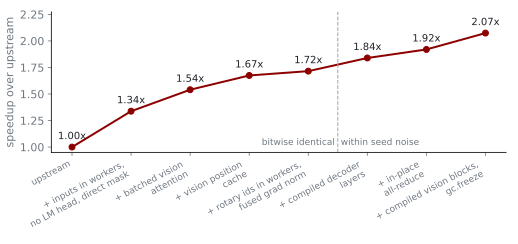
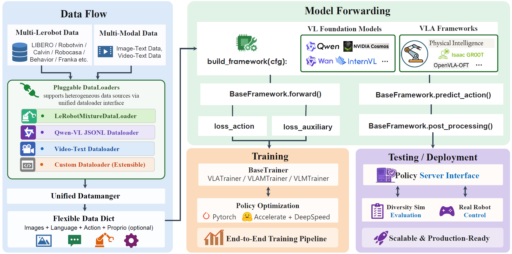
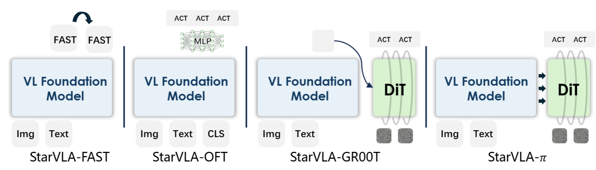
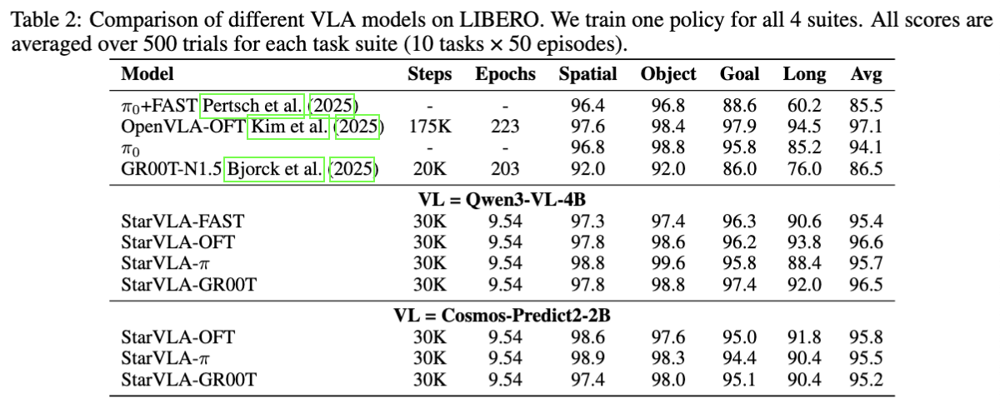

# Faster-StarVLA

[English](README.md) | [简体中文](README.zh-CN.md)

**starVLA 的训练步快 2.00×，由 AI agent 按 [ResearchBoost-Agent](https://github.com/DAGroup-PKU/ResearchBoost-Agent) 的方法优化。**


| 实现 | 每个训练步耗时 (ms) ↓ | 加速比 ↑ |
|---|---:|---:|
| 基线 | 905.4 | 1.00× |
| Faster-StarVLA，`STARVLA_FAST=exact`（逐位一致） | 521.9 | 1.74× |
| **Faster-StarVLA，`STARVLA_FAST=all`** | **453.3** | **2.00×** |

在 **2 × NVIDIA B300** 上，用 starVLA 的 [LIBERO 配方](examples/simBenchmarks/LIBERO/README.md)测得：QwenOFT 框架、
Qwen3-VL-4B 底座、每卡 batch 16、全部 45.0 亿参数可训练。`exact` 档下，确定性模式的训练步与基线
**逐位相同**。[环境与测量细节](docs/faster/measurement.md)；[其他框架和底座](#其他框架和底座)。

这些数字来自冻结基线计时的那一次测量。之后的三次测量里基线本身更快（796–816 ms，而不是 905 ms），同样的比较得到 `all` 1.87×–1.96×、`exact` 1.56×–1.65×（[各次测量](docs/faster/measurement.md#the-judge-on-the-unified-code)）。

## 快速开始

环境、权重和数据按[上游说明](README.upstream.md)准备。所有框架和底座都用同一个环境变量选择加速路径：

```bash
export STARVLA_FAST=all      # 全部加速路径：2.00x
# export STARVLA_FAST=exact  # 只开与基线逐位一致的加速路径：1.74x

bash examples/simBenchmarks/LIBERO/train_files/run_libero_train.sh
```

不设置（或设为 `off`）时，代码走的是基线路径。每条加速路径会检查拿到的模型，不适用时自动跳过；日志里会写明开了哪些：

```
[starVLA.fast] _QWen3_VL_Interface: attn_mask, hidden_only, vision_attn, vision_pos, vision_attn_relaxed, compile_lm, compile_vision
[starVLA.fast] DeepSpeedEngine: grad_norm, allreduce
```

可以按名字增减单条路径（`STARVLA_FAST=exact,-worker_prep,compile_lm`）。推理也用同一个变量：启动策略服务器前设置即可。

## 优化过程

在 2 × B300 上用 LIBERO 配方测得。图中每个点是一次计时运行，对比冻结的基线计时（906.9 ms）；最终的三进程检查
结果是 1.9975×。[工作记录](docs/faster/WORK_LOG.md)里包括没有效果的尝试。



## 改了什么

- **输入处理（`worker_prep`）：** 提示词拼接、Qwen3-VL processor 和旋转位置索引（每步约 0.2 秒单线程
  CPU，期间 GPU 在等）从训练进程挪到数据加载进程。
- **视觉塔（`vision_attn`、`vision_pos`、`compile_vision`）：** 每层一次批量注意力调用，取代逐张图片各算一次、每层还要和主机同步一次的做法；位置表只建一次；24 个 block 用 Inductor 编译。
- **语言模型（`hidden_only`、`attn_mask`、`compile_lm`）：** 不再计算用不到的词表 logits；注意力掩码由两次广播运算得到，取代四层嵌套的 `torch.vmap`；36 层解码器在训练调用时用 Inductor 编译，并用
  `gc.freeze()` 消除编译带来的垃圾回收停顿。
- **DeepSpeed ZeRO-2（`grad_norm`、`allreduce`）：** 梯度裁剪的范数不再把每个梯度
  转成 fp64（每步写入再读回 18 GB）；梯度桶原地 all-reduce。


全部代码在一个包里：[`starVLA/fast/`](starVLA/fast/__init__.py)，只在四个不属于任何框架的位置被调用：构建底座处
（`get_vlm_model`）、构建框架处（`build_framework`）、训练脚本拿到 DeepSpeed 引擎处、构建数据加载器处。
任何框架和底座接口里都没有开关，也没有一行加速代码。

[每项改动为什么有效、各自实测多少](docs/faster/measurement.md#what-changed-in-detail)。

## 其他框架和底座

starVLA 是一个包含很多策略和底座的框架。上面的主要数字来自一个配方（QwenOFT + Qwen3-VL-4B）。同一个设置用在其他
框架上的结果（硬件、数据、batch 相同，每一行都与同一作业里测的基线比较）：

| 框架 | 底座 | 配方里的注意力实现 | 基线 (ms/步) | `exact` | `all` | `all,tf32` | `exact` 逐位核对 |
|---|---|---|---:|---:|---:|---:|---|
| QwenOFT | Qwen3-VL-4B | SDPA | 801.8 | 492.9 (1.63×) | 420.8 (1.91×) | 415.0 (1.93×) | 评判程序：23,336 个张量；728 个梯度 + 动作 ✓ |
| QwenGR00T | Qwen3-VL-4B | SDPA | 905.0 | 603.5 (1.50×) | 498.2 (1.82×) | 500.4 (1.81×) | 960 个梯度 + 动作 ✓ |
| QwenPI | Qwen3-VL-4B | SDPA | 1291.5 | 1110.2 (1.16×) | 976.2 (1.32×) | 664.3 (1.94×) | 1,225 个梯度 + 动作 ✓ |
| QwenPI_v3 | Qwen3-VL-4B | SDPA | 1679.6 | 1430.6 (1.17×) | 1012.3 (1.66×) | 702.3 (2.39×) | 1,376 个梯度 + 动作 ✓ |
| QwenDiscreteDiffusion | Qwen3-VL-4B | SDPA | 2507.8 | 2295.9 (1.09×) | 2062.1 (1.22×) | 739.4 (3.39×) | 1,220 个梯度 + 动作 ✓ |
| QwenAdapter | Qwen3-VL-4B | SDPA | 999.2 | 767.8 (1.30×) | 668.4 (1.49×) | — | 1,226 个梯度 + 动作 ✓ |
| LangForce | Qwen3-VL-4B | SDPA | 1414.9 | 894.8 (1.58×) | 719.2 (1.97×) | 720.9 (1.96×) | 961 个梯度 + 动作 ✓ |
| QwenDual | Qwen3-VL-4B | SDPA | 1308.0 | 966.7 (1.35×) | 680.6 (1.92×) | — | 1,135 / 1,136 个梯度 + 动作（另 1 个上游自身两次运行也不同） ✓ |
| QwenOFT | Qwen2.5-VL-3B | SDPA | 1176.3 | 573.5 (2.05×) | 466.1 (2.52×) | — | 840 个梯度 + 动作 ✓ |
| QwenOFT | Qwen2.5-VL-3B | flash-attention | 877.6 | 645.6 (1.36×) | 466.5 (1.88×) | — | 840 个梯度 + 动作 ✓ |
| QwenGR00T | Qwen2.5-VL-3B | flash-attention | 960.9 | 754.5 (1.27×) | 569.1 (1.69×) | 554.7 (1.73×) | 1,072 个梯度 + 动作 ✓ |
| PI0 | PaliGemma (openpi) | eager | 639.6 | 644.0 (0.99×) | 483.2 (1.32×) | 483.8 (1.32×) | — |
| PI05 | PaliGemma (openpi) | eager | 667.2 | 664.7 (1.00×) | 551.0 (1.21×) | 549.4 (1.21×) | — |

| 加速路径 | 档位 | 适用范围 |
|---|---|---|
| `worker_prep` | exact | 所有把 batch 的图像和提示词交给底座接口（`build_qwenvl_inputs`）的框架，底座接口为 Qwen2.5-VL、Qwen3-VL、Cosmos-Reason2；会改写提示词的框架用一个函数登记改写方式 |
| `attn_mask` | exact | transformers 里用 `masking_utils` 构建掩码的底座（Qwen、Gemma、Llama、Phi 系列），且注意力实现为 SDPA |
| `hidden_only` | exact | 任何带 LM head 的底座，调用时只要隐状态、不带 labels |
| `vision_attn` | exact | Qwen2-VL / Qwen2.5-VL / Qwen3-VL 视觉塔，注意力实现为 SDPA；只在当前 GPU 上自检确认批量调用逐位一致的图像形状上启用 |
| `vision_pos` | exact | Qwen2-VL / Qwen2.5-VL / Qwen3-VL 视觉塔 |
| `grad_norm`、`allreduce` | exact | 任何用 DeepSpeed ZeRO-2 训练的框架 |
| `worker_examples` | exact | PI0 / PI05：框架自己的样本预处理（图像缩放与填充、状态和动作填充）放到 DataLoader 工作进程里做 |
| `sdpa` | all | 用 flash-attention 加载的 Qwen 底座切换到 PyTorch 的 scaled-dot-product attention（同一种注意力，换一个实现），下面针对 SDPA 的路径和编译层才能生效 |
| `vision_attn_relaxed` | all | 对所有尺寸一致的图像形状做批量视觉注意力（末位舍入可能不同） |
| `compile_lm`、`compile_vision` | all | 有 `model.language_model.layers` / `model.visual.blocks` 的底座（Qwen-VL 系列），且注意力实现为 SDPA |
| `condition_once` | all | 基于 starVLA 交叉注意力 DiT 的动作头（GR00T、逐层 flow matching、离散扩散）：框架为多个噪声水平复制的条件特征只投影一次 |
| `unused_views` | all | PI0 / PI05：整个 batch 都没有的相机视角直接跳过，不再当作全黑图像编码 |
| `openpi_sdpa` | all | PI0 / PI05：SigLIP 视觉塔和 PaliGemma / 动作专家的联合层改用融合的 scaled-dot-product attention，取代“矩阵乘、fp32 softmax、矩阵乘” |
| `tf32` | 按名字 | 动作头 fp32 矩阵乘用 TF32（`STARVLA_FAST=all,tf32`）：属于精度设置，所以不在 `all` 里 |

每一行都与同一个批处理作业里测的基线比较。同一节点上，不同作业之间同一配方的基线会相差最多 10%，所以不同作业的毫秒数不能直接比，行内的倍数可以比（见[各次测量](docs/faster/measurement.md#other-frameworks-and-backbones-step-time)）。

`exact` 的收益来自 VLM 输入处理和底座本身：这部分占比大的配方收益大（LangForce 每步构建两套 prompt：1.58×），PI0 / PI05 很小（0.99×），因为它们的一步基本就是 PaliGemma 的前向和反向。

flow-matching 动作头跑在 fp32。`condition_once`（属于 `all`）把框架为多个噪声水平复制的条件特征改成每个样本只投影一次。`all,tf32` 再让动作头的 fp32 矩阵乘使用 TF32；动作头每一层都要投影 VLM 隐状态的框架，剩下的时间大部分就是这些矩阵乘（QwenPI 976 → 664 ms；QwenPI_v3 1012 → 702 ms）。TF32 是精度设置而不是运算顺序的变化，所以只能按名字开启。评判程序在主配方上判定 `STARVLA_FAST=all,tf32` 统计等价；其他框架在计时的 220 步里 loss 曲线与基线没有可分辨的差别（[数据](docs/faster/measurement.md#tf32)）。

Qwen2.5-VL 的配方默认用 flash-attention 加载底座。`exact` 保留 flash-attention，只启用与注意力实现无关的路径。`all` 先把底座切到 PyTorch 的 scaled-dot-product attention（`sdpa`），之后针对 SDPA 的路径和编译层才能生效：QwenOFT 878 → 646 (1.36×) → 467 (1.88×) ms。

Qwen2.5-VL 用 SDPA 时（bf16、B300），4 个全注意力视觉层（32 张图 × 256 个 patch，head 维度 80）没有通过逐位自检，所以 `exact` 只对 28 个窗口注意力层做批量；`all` 两种都做。

PI0 和 PI05 自带 PaliGemma，不走 `get_vlm_model`。它们的 `exact` 是 `worker_examples` 加两条 DeepSpeed 路径；`all` 再加 `unused_views`（LIBERO 只有这类模型所需三个相机视角中的两个，前缀从 816 个 token 缩到 560 个）和 `openpi_sdpa`。

没有实测：Qwen3.5 和 Gemma 4 底座（需要比当前环境更新的 transformers）、MiniCPM-V、Florence-2、Molmo2、VILA，以及真实的
Cosmos-Reason2 权重（它的接口只在 CPU 测试里用 Qwen3-VL 结构跑过）；QwenFast（它把标签文本交给接口，`worker_prep` 遇到这种调用会
留给训练进程处理）、InternVLA-M1 和 ABot-M0；世界模型和纯视觉框架；co-training 与 VLM 训练脚本（它们调用的是同样的入口）。

## 验证

所有结论都来自优化开始之前就构建并冻结的评判程序（[docs/faster/judge/](docs/faster/judge/)，
[判定方式](docs/faster/measurement.md#the-judge)）。

**`STARVLA_FAST=exact`。** 打开适用于这个配方的七条逐位一致的加速路径，在确定性模式下跑两个 2 步训练用例（其中一个在两步之间插入配方里的周期性
评估），两张卡都记录：23,336 个张量（loss，以及全部 729 个参数的 fp32 梯度、更新量和两个 Adam 状态）与上游
逐位相同；学习率、随机数状态、喂给 VLM 的输入摘要也都相同。

**`STARVLA_FAST=all`。** 编译层会改变浮点舍入，所以完整集合用统计方式比较：确定性模式下、与上游同一个种子，跑一条 60 步的
训练轨迹；每个端点与上游的差必须在上游自身种子间标准差（6 个种子，优化前冻结）的 3σ 之内。

| 端点 | 差值 / 上游种子 σ | 在 3σ 内 |
|---|---:|:---:|
| Training loss, steps 20-40 | +0.87 | ✓ |
| Training loss, steps 40-60 | +0.95 | ✓ |
| Held-out probe loss, steps 50-60 | +0.12 | ✓ |
| Action-head update size, steps 10-60 | +0.29 | ✓ |
| VLM update size, steps 10-60 | -0.40 | ✓ |
| Action-head update size, top elements, steps 1-6 (tracks the learning rate) | +0.22 | ✓ |
| VLM update size, top elements, steps 1-6 (tracks the learning rate) | -0.31 | ✓ |

把所有学习率乘以 1.02 的对照运行会被这项检查拒绝（更新量端点偏离 +16σ）；让 VLM 收不到梯度的版本、改了裁剪阈值的
版本同样被拒绝。

**在当前代码上。** 上面的检查是在首版上做的，当时加速路径还没有统一到 `STARVLA_FAST`，也没有扩展到其他框架。在当前代码上，评判程序再次确认 `STARVLA_FAST=exact` 逐位一致：23,336 个张量中 23,336 个相同；之后跑过这项检查的四次测量都是如此。`STARVLA_FAST=all` 的三进程检查在之后的测量里都没有给出结论：基线比冻结计时快，超出了允许的范围，评判程序按规则拒绝判定（INVALID）。它自己测到的加速比是 1.87×–1.96×。代理式检查（与冻结计时比较并跑统计门）对 `all,tf32` 判定通过（等级 N2，各端点在 1.41σ 以内）。[详情](docs/faster/measurement.md#the-judge-on-the-unified-code)。

**LIBERO 评测。** 用全部加速路径完整训练一次（30,000 步，种子 42，2 × B300，全局 batch 32），按 starVLA 的 LIBERO 协议
评测（每个套件 500 个 episode），并在同一条评测管线里评测官方发布的 checkpoint。官方 checkpoint 由 starVLA 作者在
8 张 GPU 上训练（全局 batch 128，取第 50,000 步）；这里只是检查加速后的代码能训出可用的策略，不是同种子的对照。这 30,000 步
实际用时 3 小时 51 分钟（含配方里的周期性评估和三次 checkpoint 保存，平均每步 462 ms）；按冻结的上游单步耗时估算，
只算训练步就要 7.6 小时（没有实际跑）。

| Success rate (%) | Spatial | Object | Goal | Long | Avg |
|---|---:|---:|---:|---:|---:|
| starVLA Qwen3-VL-OFT, published | 97.8 | 98.6 | 96.2 | 93.8 | 96.6 |
| Released checkpoint (`StarVLA/Qwen3-VL-OFT-LIBERO-4in1`, step 50,000), our evaluation | 98.6 | 100.0 | 99.4 | 96.6 | 98.65 |
| **Faster-StarVLA run** (all fast paths, 30,000 steps on 2 GPUs) | 98.8 | 98.6 | 98.4 | 93.4 | 97.30 |

## 更快的评测

`tools/eval/` 里是上面评测用的合批策略服务器：仿真客户端的并发请求合成一次 `predict_action` 调用，不再一个一个
排队。见 [docs/faster/measurement.md](docs/faster/measurement.md#evaluation)。

## 上游 starVLA 文档

基于 [starVLA/starVLA](https://github.com/starVLA/starVLA) 的 `99764f5`，作者为 StarVLA Community。
[论文](https://arxiv.org/abs/2604.05014) · [项目主页](https://starvla.github.io/) · [MIT 许可](LICENSE)。原 README
（[README.upstream.md](README.upstream.md)）和作者信息保留在下方。

<details>
<summary>starVLA 原 README：环境、数据、训练与评测</summary>

<p align="center">

</p>
<h1 align="center">StarVLA: A Lego-like Codebase for Vision-Language-Action Model Developing</h1>

<p align="center">An open-source research platform for integrating and exploring cutting-edge technologies for generalist robots.</p>

<p align="center">
<a href="https://starvla.github.io/"></a>
<a href="https://huggingface.co/StarVLA"></a>
<a href="https://arxiv.org/abs/2604.05014"></a>
<a href="https://github.com/starVLA/starVLA/issues/64#issuecomment-3715403845"></a>
</p>

> **📢 Citation Update:** Our technical report is now on arXiv ([2604.05014](https://arxiv.org/abs/2604.05014)). We kindly invite you to use the [updated BibTeX](#citation) for any ongoing or future citations. If you have already cited StarVLA in a previous version of your work, we would greatly appreciate it if you could update the citation entry in your camera-ready or future revisions. Thank you for your understanding and support! 🙏

---

In StarVLA (also a pun on "start VLA" ),  each functional component (model, data, trainer, config, evaluation, etc.) follows a top-down, intuitive separation and high-cohesion, low-coupling principle, enabling plug-and-play design, rapid prototyping, and independent debugging.

## Our Team's Work

<details open>
<summary><b>Explore our research</b></summary>
<br>

StarVLA is a powerful and flexible codebase for robotics research. It is also an official implementation of the following work:

- **StarVLA: A Lego-like Codebase for Vision-Language-Action Model Developing**<br>
  [ Codebase & Infrastructure ] [ StarVLA ] - [ [Paper](https://arxiv.org/abs/2604.05014) ] [ [Project](https://starvla.github.io/) ] [ [Code](https://github.com/starVLA/starVLA) ] [ [Bib](#citation) ]

- **StarVLA-α: Reducing Complexity in Vision-Language-Action Systems**<br>
  [ Evaluation ] [ StarVLA-α ] - [ [Paper](https://arxiv.org/abs/2604.11757) ] [ [Code](https://github.com/starVLA/starVLA-alpha) ] [ [Bib](#citation) ]

- **Beyond Data Scaling: Representation-Centric Continued Pre-training for Vision-Language-Action Models**<br>
  [ Pre-training ] [ VLAct ] - [ [Paper](https://arxiv.org/abs/2608.27550) ] [ [Project](https://starvla.github.io/VLAct/) ] [ [Code](https://github.com/starVLA/VLAct) ] [ [Models](https://huggingface.co/collections/StarVLA/vlact-6a903c2e0c176179da425c96) ] [ [Bib](#citation) ]

</details>

## News

> **⚠️ Branch notice:** The `starVLA_dev` branch is where we actively merge new features and may be temporarily unstable. For verified results, use the stable `starVLA` branch. Thanks to StarVLA's low-coupling design, switching between branches is painless. We encourage trying `starVLA_dev` and welcome PRs if you spot any issues!

> **💡 Tip:** Files under any `**/bar/` directory are git-ignored, so you can place your custom scripts there (e.g., `examples/simBenchmarks/LIBERO/train_files/bar/my_train.sh`) without polluting the repo.

**[2026/09/05]** 🏠 We have updated the [RoboCasa365 (PandaOmron) integration](examples/simBenchmarks/Robocasa_365) with a consolidated data, training, and evaluation guide and a 50-task local research snapshot covering StarVLA-OFT, StarVLA-PI, and StarVLA-GR00T. The best selected local result is **StarVLA-PI at 40.64% (1,016/2,500)**. These target-task/target-kitchen results are provided for research reference and are not official RoboCasa leaderboard submissions.

**[2026/08/27]** 🚀 We released **[VLAct](https://starvla.github.io/VLAct/)** and its paper, [*Beyond Data Scaling: Representation-Centric Continued Pre-training for Vision-Language-Action Models*](https://arxiv.org/abs/2608.27550). VLAct introduces representation-centric continued pre-training for reusable VLA backbones; the [code](https://github.com/starVLA/VLAct) and [models](https://huggingface.co/collections/StarVLA/vlact-6a903c2e0c176179da425c96) are now public. If you already use a Qwen3-VL-4B StarVLA recipe, set `framework.qwenvl.base_vlm` to [`StarVLA/VLAct_Qwen3_Pretrain`](https://huggingface.co/StarVLA/VLAct_Qwen3_Pretrain) to try the VLAct-pretrained backbone directly.

**[2026/08/09]** 🤖 StarVLA now supports [RoboDojo through XPolicyLab](examples/simBenchmarks/RoboDojo). The example provides training recipes for the official RoboDojo dataset and a path-based entry point for evaluating the released checkpoints with XPolicyLab.

**[2026/06/22]** 🔥 We are creating a [StarVLA Contributors Group](https://github.com/starVLA/starVLA/issues/393) to make contributor communication easier and discuss contributor list before each release. Welcome everyone to help maintain StarVLA's open-source infrastructure together.

**[2026/05/30]** 🔥 StarVLA now supports [VLA training with **Qwen-series backbones** on **Ascend NPU**](https://github.com/starVLA/starVLA/pull/336). See the [related discussion](https://github.com/starVLA/starVLA/issues/341) for details and feedback.

**[2026/04/09]** 🚀 unified **multi-benchmark co-training** example (combining LIBERO, SimplerEnv, RoboTwin, VLA-Arena, etc.) is coming soon. Stay tuned!

**[2026/05/01]** 🔥 We now provide a step-by-step guide for [integrating your own robot / dataset into StarVLA](docs/integrate_your_dataset.md).

**[2026/05/01]** 🔥 We are building [agent skills](docs/agent_skills) to make StarVLA a powerful substrate for AI coding agents — we have verified that GitHub Copilot (Claude Opus 4.7) can autonomously integrate [examples/Robocasa_365](examples/simBenchmarks/Robocasa_365) and [examples/RoboChallenge_table30v2](examples/realRobots/RoboChallenge_table30v2) from scratch. Going forward, StarVLA will be continuously optimised to be equally easy to use for humans and code agents.

**[2026/05/01]** 🙏 Special thanks to the [AllenAI](https://github.com/allenai) team for providing optimised Docker environments and evaluation-acceleration support via [vla-evaluation-harness](https://github.com/allenai/vla-evaluation-harness)! If you need to speed up large-scale VLA benchmark evaluation, we recommend checking it out.


**[2026/04/18]** 🔥 StarVLA now supports [DOMINO](examples/simBenchmarks/DOMINO), a dynamic manipulation benchmark for moving objects and time-varying scenes. Original DOMINO repository is [here](https://github.com/H-EmbodVis/DOMINO).

**[2026/04/09]** 🎯 Thanks to the [RLinf](https://rlinf.readthedocs.io) team, StarVLA now supports **RL post-training**! Check out the [StarVLA × RLinf tutorial](https://rlinf.readthedocs.io/en/latest/rst_source/examples/embodied/starvla.html) to get started.

**[2026/04/09]** 🔥 **WM4A (World Model for Action)** is now integrated! Use pretrained video-generation DiT models (Cosmos-Predict2, Wan2.2) as backbones for action prediction. See [docs/WM4A.md](docs/WM4A.md) for architecture details and training instructions. Pretrained checkpoints are available at the [StarVLA/world-model-to-vla](https://huggingface.co/collections/StarVLA/world-model-to-vla) HuggingFace collection.


**[2026/03/29]** 🔥 Thanks to the [ABot-M0](https://github.com/amap-cvlab/ABot-Manipulation) team for providing the [pre-trained weights](https://www.modelscope.cn/models/amap_cvlab/ABot-M0-Pretrain). For `Qwen3-VL 4B`, you can reload the `qwen_vl_interface` module in various frameworks!

**[2026/03/19]** 🔥 StarVLA now provides a complete real-robot development case with [Franka robot examples](https://github.com/starVLA/starVLA/pull/198)!

**[2026/03/03]** 🔥 We now support [**Qwen3.5** as a backbone for VLA](https://github.com/starVLA/starVLA/pull/172) — the fastest integration in the community ⚡
With more model size options: **0.8B, 2B, 4B, and 9B**! Build your VLA flexibly on top of native multimodal models!

**[2026/01/29]** 🔥 StarVLA [Training Efficiency Report](https://github.com/starVLA/starVLA/issues/158) & [Training Curves](https://github.com/starVLA/starVLA/issues/68) released!
Training configs and efficiency benchmarks for community reference.

**[2026/01/29]** Calvin benchmark experiments were conducted by the UNT team. For inquiries, please contact Zhijie Song (1600013008@pku.edu.cn) or Feng Yan (bphengyan@163.com).

**[2025/12/25]** We've simultaneously established pipelines for [Behavior-1K](examples/simBenchmarks/Behavior), [RoboTwin 2.0](examples/simBenchmarks/Robotwin), and CALVIN. We'd love to collaborate and share baseline results for more benchmarks with the community!

<details>
<summary><b>Prior Timeline</b></summary>

**[2025/12/25]**  We've released RoboCasa evaluation support, which was trained **without pretraining and reached SOTA performance**. Check out more details in [examples/Robocasa_tabletop](examples/simBenchmarks/Robocasa_tabletop).

**[2025/12/15]** Completed a release regression check to ensure the public code runs smoothly. Routine updates—including recent support for the LeRobot dataset v3.0 and DeepSpeed ZeRO-3—will continue to appear in the [🚧 Daily Development Log](https://github.com/starVLA/starVLA/issues/64#issue-3727060165).

**[2025/12/09]** Became the first open-source repository to support training with [train your vlm](starVLA/training/train_starvlm.py), [train your vla](starVLA/training/train_starvla.py), and [train your vla with vlm](starVLA/training/train_starvla_cotrain.py). Check out how to co-train your VLA with multimodal data in [examples/CoTrainVLM](examples/modelExtensions/CoTrainVLM/README.md).

**[2025/11/12]** We now support [Florence-2](https://github.com/anyantudre/Florence-2-Vision-Language-Model) as a smaller VLM for resource-constrained development. StarVLA can now run on a single A100 GPU. See the [🚀Train with a smaller VLM](docs/faq.md#how-to-train-with-a-smaller-vlm) section for more details.

**[2025/10/30]:** We released the LIBERO Training & Evaluation README. Results are very promising. More details are in [examples/LIBERO](examples/simBenchmarks/LIBERO).

**[2025/10/25]:** We fixed several script links and so everything is smoother now. Thanks to the community for the feedback.

</details>

## Overview and Key Features


*Overview of the StarVLA framework. StarVLA organises VLA research as a
composable stack: a shared training infrastructure, pluggable foundation-model
backbones (VLM / world model), interchangeable action heads (FAST, OFT,
flow-matching π, GR00T-style dual-system), and benchmark-agnostic deployment
hooks. Each axis is decoupled, so a new framework variant typically reduces
to swapping the backbone or the action head while reusing the rest.*

<details open>
<summary><b>Data flow diagram (click to expand)</b></summary>


*Data flow view of StarVLA. A unified, modular pipeline connects heterogeneous
data sources, pluggable dataloaders, and flexible data representations through
a standardised model-forwarding interface, enabling end-to-end training and
deployment.*

</details>

<details open>
<summary><b>Various VLA Frameworks</b></summary>

All variants share the same data interface and infrastructure; only the action head differs.

- [x] **StarVLA-FAST**: Autoregressive discrete action tokens via a fast tokenizer (à la π₀-fast).
- [x] **StarVLA-OFT**: Parallel continuous action decoding with an MLP head (à la OpenVLA-OFT/EO).
- [x] **StarVLA-PI**: Flow-Matching action expert for diffusion-based continuous actions (à la π₀).
- [x] **StarVLA-GR00T**: Dual-system architecture — VLM as System 2, Flow-Matching as System 1 (à la GR00T).

<p align="center">

</p>

</details>

<details open>
<summary><b>Various Training Recipes</b></summary>

Every recipe is paradigm-agnostic and applies uniformly to all supported frameworks.

- [x] Supervised fine-tuning (SFT)
- [x] Multimodal Multi-objectives Co-Training
- [x] Cross-embodiment Co-Training
- [ ] Reinforcement Learning Adaptation

</details>

<details open>
<summary><b>Broad Benchmark Integration</b></summary>

Achieve **state-of-the-art (SOTA) performance** on a variety of benchmarks, as follows:

- [x] **SimplerEnV**
- [x] **LIBERO**
- [x] **LIBERO-plus**
- [x] **Robocasa-GR1**
- [x] **Robocasa365**
- [x] **RoboTwin 2.0**
- [x] **DOMINO**
- [x] **BEHAVIOR**
- [x] **Calvin**
- [x] **RoboDojo**
- [ ] **SO101**
- [ ] **RLBench**

</details>

---

## 🎒 Quick Start

> **📖 New to StarVLA?** Check out our step-by-step [**Quick Start Guide**](docs/starVLA_guideline.md) — a complete walkthrough from installation to training to evaluation using the LIBERO benchmark.

---

## Benchmark Results

<details open>
<summary><b>Results on LIBERO</b></summary>

<p align="center">

</p>

</details>

<details open>
<summary><b>Results on SimplerEnv</b></summary>

<p align="center">

</p>

</details>

<details>
<summary><b>Results on RoboCasa GR1</b></summary>

<p align="center">

</p>

</details>

<details>
<summary><b>Results on Calvin_D_D</b></summary>

<p align="center">

</p>

</details>

We have more results for RoboCasa, RoboTwin 2.0, Behavior-1k, Calvin. See our [🍀 Overleaf](https://www.overleaf.com/read/qqtwrnprctkf#d5bdce), which continuously presents our real-time experimental results.

---

## Model Zoo

See the full list of released models and checkpoints in [docs/model_zoo.md](docs/model_zoo.md).

---

## Start Building Your VLA Like Lego!
👇 StarVLA achieves "Lego-like" development via the following designs:
<details>
<summary><b>1. Smoke test any submodule</b></summary>

StarVLA emphasizes a modular model design. Each major framework file can be run standalone for rapid debugging and smoke-testing your code. For example:

```bash
# model
python starVLA/model/framework/VLM4A/QwenOFT.py --config_yaml starvla_cotrain_oxe.yaml
# dataloader
python starVLA/dataloader/lerobot_datasets.py --config_yaml starvla_cotrain_oxe.yaml
```

Note: `starVLA/model/framework/VLM4A/yourframework.py` is the single external API surface of the model; it should mirror (be structurally isomorphic to) the framework diagram in your paper.

</details>

<details>
<summary><b>2. Explicit model boundaries</b></summary>

StarVLA follows top‑down decomposition and the principle of high cohesion & low coupling.

For example:
- Dataloader
  - Returns a raw, model‑agnostic dict only; no model‑specific preprocessing (e.g., tokenizer, image encoding).
  - A single sample should include (add/remove as needed):
    - image: list[PIL.Image] | np.ndarray
    - lang: str
    - action: np.ndarray[T, action_dim]
    - state: Optional[np.ndarray[..., state_dim]]

Both `framework.forward()` and `framework.predict_action()` operate directly on raw inputs, keeping train/test boundaries explicit and easy to hack.

</details>

<details>
<summary><b>3. Flexible configuration system</b></summary>

StarVLA uses a single global configuration object
Parameters are passed primarily via extensible dicts, allowing overrides and controlled redundancy.

</details>


<!-- 🧪 *To self‑test and iterate on StarVLA's usability, we re‑implemented several representative VLA frameworks. We have done a beta test: an internal developer can stand up a new VLA framework in under half a day (less than 3 hours), and a new user can build their first custom VLA framework within a single day. More design insights for each item can be found in *[*assets/intro_v1.md*](assets/intro_v1.md)*.* -->

---

## FAQ

See [docs/faq.md](docs/faq.md) for common questions on configuration, freezing, learning rates, checkpointing, smaller VLMs, and more.

## Contributing

Community contributors are the driving force behind StarVLA's growing ecosystem. We deeply appreciate every PR, bug fix, and piece of feedback from the open-source community — your efforts keep StarVLA evolving rapidly. A full, continuously updated contributor list is maintained at [starvla.github.io/contributors](https://starvla.github.io/contributors).

Thanks to all the people who have contributed to StarVLA:

<a href="https://github.com/starVLA/starVLA/graphs/contributors">

</a>

See [docs/CONTRIBUTING.md](docs/CONTRIBUTING.md) for guidelines on reporting bugs, proposing features, and submitting PRs.

### Projects Based on StarVLA

**NeuroVLA**: [*A Brain-like Embodied Intelligence for Fluid and Fast Reflexive Robotics Control*](https://github.com/guoweiyu/NeuroVLA)

**PhysBrain**: [*Human Egocentric Data as a Bridge from Vision Language Models to Physical Intelligence*](https://zgc-embodyai.github.io/PhysBrain)

**TwinBrainVLA**: [*TwinBrainVLA: Unleashing the Potential of Generalist VLMs for Embodied Tasks via Asymmetric Mixture-of-Transformers*](https://github.com/ZGC-EmbodyAI/TwinBrainVLA)

**LangForce** (ICML 2026): [*LangForce: Bayesian Decomposition of Vision Language Action Models via Latent Action Queries*](https://github.com/ZGC-EmbodyAI/LangForce)

**LaWAM**: [*LaWAM: Latent World Action Models for Efficient Dynamics-Aware Robot Policies*](https://github.com/RLinf/LaWAM)

Examples:
```bash
accelerate launch \
  --config_file starVLA/config/deepseeds/deepspeed_zero2.yaml  \
  --num_processes 8 \
  starVLA/training/train_internvla.py \
  --config_yaml examples/simBenchmarks/SimplerEnv/train_files/starvla_cotrain_oxe.yaml \
  --framework.qwenvl.base_vlm Qwen/Qwen2.5-VL-7B-Instruct \ # override framework choice
  --framework.qwenvl.base_vlm Qwen/Qwen2.5-VL-7B-Instruct \ # override framework choice
  --framework.action_model.new_module ${module_name} \ # plug-in a new module to action model
```

⚠️: `framework.action_model.new_module` only adds to the global config; its behavior is on your framework.


</details>

<details close>
<summary><b>Q: Can I freeze the VLM via parameters?</b></summary>

A: Yes. StarVLA uses a regex / name list to control freezing. Example:
```
--trainer.freeze_modules "qwen_vl_interface.model.model.visual,dino_encoder" \
```
Tips: You can ``print(your_model)`` first to check the relative paths of your modules and list them as comma-separated values.
(implementation in `TrainerUtils.freeze_backbones`.)

</details>

<details close>
<summary><b>Q: Can I set different learning rates for different modules?</b></summary>

A: Yes, starVLA also uses name: value dict to control learning group. Config example:
```yaml
trainer:
  learning_rate:
    base: 1e-05      # other modules
    qwen_vl_interface: 1.0e-05
    action_model: 1.0e-04
```
(Also referenced in `trainer_tools.build_param_lr_groups`.)
</details>

<details close>
<summary><b>Q: Can I resume training from a checkpoint?</b></summary>

A: Yes, somehow can. Specify the latest checkpoint path in `config.yaml`, e.g.:
```yaml
trainer:
  pretrained_checkpoint: path_to_steps_10000.pt
  reload_modules: "action_model"
```
Empty `reload_modules` means full load all model. However, starVLA does not save  `optimizer state`. It requires a lot of  memory/disk and bring limited benefit.
</details>


<details id="train-smaller-vlm" close>
<summary><b>🚀 Train with a smaller VLM</b></summary>

```bash
    accelerate launch \
      --config_file starVLA/config/deepseeds/deepspeed_zero2.yaml \
      --main_process_ip $MASTER_ADDR \
      --main_process_port $MASTER_PORT \
      --machine_rank $SLURM_PROCID \
      --num_machines $SLURM_NNODES \
      --num_processes=${TOTAL_GPUS} \
      starVLA/training/train_starvla.py \
      --config_yaml examples/simBenchmarks/SimplerEnv/train_files/starvla_cotrain_oxe.yaml \
      --framework.name QwenGR00T \
      --framework.qwenvl.base_vlm microsoft/Florence-2-large \
      --run_root_dir ${run_root_dir} \
      --run_id ${run_id} \
      --wandb_project your_project \
      --wandb_entity your_name
```

Note: To ensure better compatibility with already released checkpoints, we are continuing to use `--framework.qwenvl`. This parameter will be unified in the next release.

</details>


<a id="citation"></a>

## ✍️ Citation & Copyright

StarVLA is released under the MIT License, which permits commercial use, modification, distribution, and private use. Rebases are allowed for forks and feature branches; when rebasing from upstream StarVLA, use descriptive commit messages (e.g., "chore: rebase from StarVLA") and keep at least the two latest upstream commits as separate. See [License](LICENSE) for details.

```bibtex

@article{yang2026beyond,
  title={Beyond Data Scaling: Representation-Centric Continued Pre-training for Vision-Language-Action Models},
  author={Yang, Senqiao and Wang, Chengyao and Chen, Yuxin and Wang, Zixuan and Tang, Longxiang and Gui, Haokun and Ye, Jinhui and Lu, Changsheng and Wu, Xiaoyang and Zhu, Mingkang and others},
  journal={arXiv preprint arXiv:2608.27550},
  year={2026}
}

@inproceedings{ye2026starvla,
  title={StarVLA-$$\backslash$alpha $: Reducing Complexity in Vision-Language-Action Systems},
  author={Ye, Jinhui and Gao, Ning and Yang, Senqiao and Zheng, Jinliang and Wang, Zixuan and Chen, Yuxin and Chen, Pengguang and Chen, Yilun and Liu, Shu and Jia, Jiaya},
  booktitle = {European Conference on Computer Vision (ECCV)},
  year      = {2026}
}

@article{community2026starvla,
  title={StarVLA: A Lego-like Codebase for Vision-Language-Action Model Developing},
  author={{StarVLA Community}},
  journal={arXiv preprint arXiv:2604.05014},
  year={2026},
  eprint={2604.05014},
  archivePrefix={arXiv},
  primaryClass={cs.RO}
}
```

## Acknowledgements
This project draws inspiration and references from several notable open-source initiatives, including:
- [LeRobot](https://github.com/huggingface/lerobot)
- [GR00T](https://github.com/NVIDIA/Isaac-GR00T/tree/main)
- [DeepSpeed](https://github.com/deepspeedai/DeepSpeed)
- [Qwen-VL](https://github.com/QwenLM/Qwen3-VL/tree/main)
- [InternVL](https://github.com/OpenGVLab/InternVL)
- [ABot-Manipulation](https://github.com/amap-cvlab/ABot-Manipulation)

The codebase was originally forked from [InternVLA-M1](https://github.com/InternRobotics/InternVLA-M1).

## Star History
Here's how our community has grown over time:

[](https://star-history.dera.page/#starVLA/starVLA&type=date&legend=bottom-right)


<!-- *Chart updates automatically. Click to interact with the full timeline.* -->

</details>
