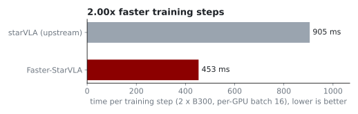
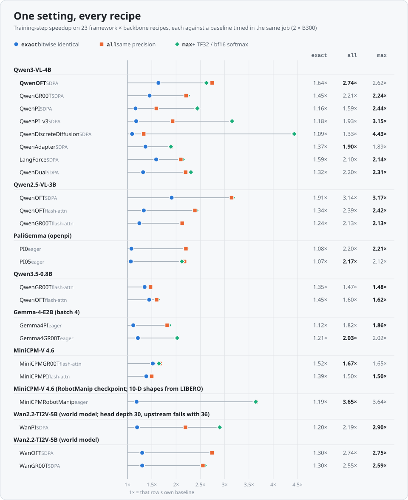
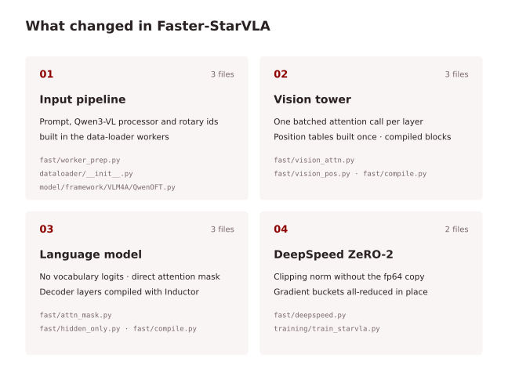

# Faster-StarVLA

[English](README.md) | [简体中文](README.zh-CN.md)

**一个环境变量，starVLA 训练步快 2.00×。由 AI agent 按 [ResearchBoost-Agent](https://github.com/DAGroup-PKU/ResearchBoost-Agent) 的方法优化。**

<p align="center">
  <picture>
    <source media="(prefers-color-scheme: dark)" srcset="docs/faster/figures/benchmark-dark.svg">
    
  </picture>
</p>

| 实现 | 每个训练步耗时 (ms) ↓ | 加速比 ↑ |
|---|---:|---:|
| 基线 | 905.4 | 1.00× |
| `STARVLA_FAST=exact`（逐位一致） | 521.9 | 1.74× |
| **`STARVLA_FAST=all`**（统计等价） | **453.3** | **2.00×** |

在 **2 × NVIDIA B300** 上用 starVLA 的 LIBERO 配方测得（QwenOFT + Qwen3-VL-4B，每卡 batch 16，全部参数可训练）。
配置、脚本和框架都不用改。[测量细节](docs/faster/measurement.md)。

## 快速开始

按[上游说明](README.upstream.md)准备好环境，然后：

```bash
export STARVLA_FAST=all      # 2.00x；也可以选 exact（1.74x，逐位一致）或 max（再加 TF32 / bf16 softmax）
bash examples/simBenchmarks/LIBERO/train_files/run_libero_train.sh
```

每条加速路径先检查拿到的模型，不适用就跳过，启动日志会列出开了哪些。可以按名字增减：`STARVLA_FAST=all,-compile_lm`。
推理服务器用同一个变量。

## 所有配方

23 个框架 × 底座组合，每个都和同一作业里测的自己的基线比：`all` 为 1.33×–3.65×，`max` 最高 4.43×（QwenDiscreteDiffusion + Qwen3-VL-4B）。

<p align="center">
  <picture>
    <source media="(prefers-color-scheme: dark)" srcset="docs/faster/figures/coverage-dark.svg">
    
  </picture>
</p>

[完整表格、说明和没测到的部分](docs/faster/details.zh-CN.md#其他框架和底座)。

## 优化过程

每一列是主配方的一次计时，对比冻结的基线（906.9 ms）。[工作日志](docs/faster/WORK_LOG.md)里也记了没起作用的轮次。

<p align="center">
  <picture>
    <source media="(prefers-color-scheme: dark)" srcset="docs/faster/figures/history-dark.svg">
    
  </picture>
</p>

- **数据加载：** 拼 prompt、VLM processor 和旋转位置编码挪到 loader 的 worker 里做。
- **视觉塔：** 每层一次批量注意力，而不是每张图一次；位置表缓存；编译各层。
- **语言模型：** 不算用不到的词表 logits；直接构造注意力 mask；编译解码层。
- **优化器步：** 算裁剪范数时不再把每个梯度拷成 fp64；原地 all-reduce；编译版 AdamW 更新。
- **其他底座：** 世界模型不再把实际上冻结的文本编码器和 VAE 放进优化器（Wan 上每步省约 100 ms，峰值显存少 42–52 GiB）；
  MiniCPM-V 按块切的视觉塔保持在 flash-attention 上（快 3 倍）。

## 工作原理

<p align="center">
  <picture>
    <source media="(prefers-color-scheme: dark)" srcset="docs/faster/figures/module-map-dark.svg">
    
  </picture>
</p>

全部代码在一个包 [`starVLA/fast/`](starVLA/fast/__init__.py) 里，只从四个与框架无关的入口调用：构建底座、构建框架、
创建 DeepSpeed 引擎、构建数据加载器。

| 档位 | 加了什么 | 与上游相比 |
|---|---|---|
| `exact` | 把工作挪出关键路径，或者干脆不做 | **逐位一致**（确定性模式） |
| `all` | 编译层等同精度下的重排 | 在上游种子间波动的 **3σ** 以内 |
| `max` | fp32 动作头用 TF32、PI0 / PI05 的 softmax 用 bf16 | 统计等价，部分运算精度降低 |

[全部 28 条加速路径](docs/faster/details.zh-CN.md#全部加速路径) · [常见问题](docs/faster/details.zh-CN.md#常见问题)

## 验证

由优化开始前就冻结的评判程序判定（[判定方法](docs/faster/details.zh-CN.md#验证)）：

- **`exact`：** 两个训练步里记录的 23,336 个张量（loss、每个 fp32 梯度、更新量和 Adam 状态）与上游逐位相同。
- **`all`：** 每个训练端点都在上游自身种子间波动的 3σ 以内；学习率 ×1.02 的对照会被拒绝。
- **端到端：** 开全部加速路径训 30,000 步，LIBERO 平均成功率 97.3%（官方 checkpoint 按同样方式评测：98.65%）。

## 上游 starVLA

基于 StarVLA Community 的 [starVLA/starVLA](https://github.com/starVLA/starVLA)（`99764f5`，[论文](https://arxiv.org/abs/2604.05014)，
[MIT 许可](LICENSE)）。环境、数据、训练和评测见 [README.upstream.md](README.upstream.md)。
